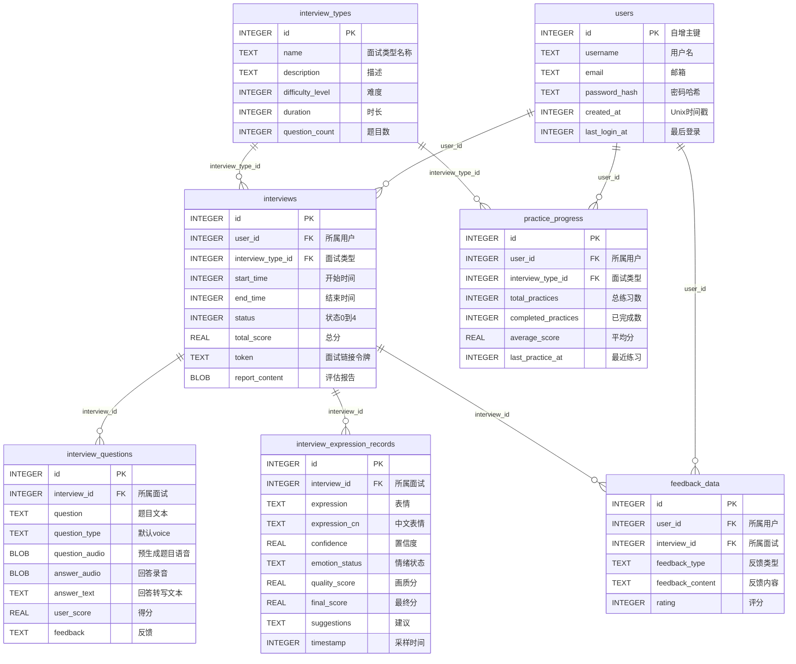

# AI智能面试系统

一个基于AI的自动化面试系统，能够根据候选人简历和岗位需求自动生成面试问题，支持在线语音面试，并能自动生成面试评估报告。

## 功能特点

- **智能面试问题生成**：基于候选人简历和岗位要求，自动生成针对性面试问题
- **在线语音面试**：候选人可通过网页进行语音回答，系统自动录音
- **自动面试评估**：系统自动分析面试表现，生成详细的面试评估报告
- **完整招聘管理**：支持岗位管理、候选人管理和面试流程管理
- **定时自动处理**：定期检查并处理待生成的面试问题和面试报告
- **多样化面试官风格**：提供6种不同风格的虚拟面试官，适应不同岗位和面试场景
- **智能语音合成**：集成阿里云cosyvoice-v3-flash大模型，支持语音预生成，提升用户体验
- **支付功能**：支持套餐购买、免费试用和增值服务，集成支付宝支付
- **用户认证**：支持用户注册登录、配额管理

## 面试官风格

系统提供6种不同风格的虚拟面试官，每种面试官在问题生成和评估报告上都有独特的风格特点：

### 风格对比

| 面试官类型      | 风格特点        | 问题风格        | 评估重点      | 适用场景       |
| ---------- | ----------- | ----------- | --------- | ---------- |
| **专业男面试官** | 沉稳专业，注重技术深度 | 技术深度问题、逻辑推理 | 技术能力、逻辑思维 | 技术岗位面试     |
| **专业女面试官** | 温柔专业，注重综合能力 | 综合能力问题、沟通表达 | 综合能力、团队协作 | 综合岗位面试     |
| **亲和男面试官** | 亲切友好，营造轻松氛围 | 开放性问题、情景模拟  | 个人特质、发展潜力 | 初级岗位、实习生面试 |
| **亲和女面试官** | 活泼亲切，缓解紧张感  | 创意问题、个性展示   | 创意思维、适应能力 | 创意岗位、应届生面试 |
| **严谨男面试官** | 严肃认真，高标准要求  | 技术难题、压力测试   | 专业功底、抗压能力 | 高级技术岗位面试   |
| **严谨女面试官** | 专业严谨，有战略高度  | 战略思维、领导力问题  | 战略思维、决策能力 | 高管岗位面试     |

### 详细说明

#### 1. 专业男面试官

- **风格**：沉稳专业，注重技术深度和逻辑思维，问题严谨且有深度
- **语气**：正式、专业、客观
- **问题类型**：技术深度问题、逻辑推理问题、专业能力考察
- **评估重点**：技术能力、逻辑思维、专业深度
- **适用场景**：技术岗位面试，如软件工程师、架构师等

#### 2. 专业女面试官

- **风格**：温柔专业，注重综合能力和沟通表达，问题温和但有针对性
- **语气**：温和、专业、亲切
- **问题类型**：综合能力问题、沟通表达问题、团队协作考察
- **评估重点**：综合能力、沟通表达、团队协作
- **适用场景**：综合岗位面试，如产品经理、项目经理等

#### 3. 亲和男面试官

- **风格**：亲切友好，营造轻松面试氛围，问题开放且有趣
- **语气**：轻松、友好、鼓励
- **问题类型**：开放性问题、情景模拟问题、个人经历分享
- **评估重点**：个人特质、发展潜力、学习能力
- **适用场景**：初级岗位、实习生面试，帮助候选人放松表达

#### 4. 亲和女面试官

- **风格**：活泼亲切，缓解面试紧张感，问题活泼有趣
- **语气**：活泼、亲切、自然
- **问题类型**：创意问题、个性展示问题、轻松话题
- **评估重点**：创意思维、个性特点、适应能力
- **适用场景**：创意岗位、应届生面试，注重候选人个性展示

#### 5. 严谨男面试官

- **风格**：严肃认真，适合技术深度面试，问题严谨有挑战性
- **语气**：严肃、严谨、专业
- **问题类型**：技术难题、深度追问、压力测试问题
- **评估重点**：专业功底、抗压能力、问题解决
- **适用场景**：高级技术岗位面试，考察专业功底和抗压能力

#### 6. 严谨女面试官

- **风格**：专业严谨，适合高管岗位面试，问题有战略高度
- **语气**：专业、严谨、有深度
- **问题类型**：战略思维问题、领导力问题、决策能力考察
- **评估重点**：战略思维、领导力、决策能力
- **适用场景**：高管岗位面试，如总监、VP等

### 使用说明

1. 面试官风格在**创建面试时选择**，一旦确定后不可更改
2. 不同风格的面试官会生成不同风格的面试问题
3. 评估报告也会体现相应面试官的评估风格和语气
4. 建议根据岗位类型和候选人特点选择合适的面试官风格

## 系统架构

- **后端**：基于Python和Flask的RESTful API服务
- **前端**：使用Vue.js 3和Bootstrap 5构建的响应式Web界面
- **数据库**：使用SQLite进行数据存储
- **AI模型**：集成阿里云百炼大语言模型（OpenAI 兼容接口），出题使用 qwen-flash 文本模型，面试报告使用 qwen-plus
- **语音处理**：支持Web录音，语音转写功能可选配置Whisper模型
- **语音合成**：集成阿里云cosyvoice-v3-flash大模型，支持语音预生成
- **支付系统**：支持支付宝支付，提供套餐购买、免费试用和增值服务

## 项目结构

```
project-interview/
├── app/                                  # 主应用目录
│   ├── ai_services/                      # 智能体服务层
│   │   ├── expression_service.py         # 表情分析服务
│   │   ├── prompt.py                     # 面试提示词模板
│   │   ├── question_service.py           # 面试问题生成服务（qwen-flash）
│   │   ├── report_service.py             # 面试报告生成服务（qwen-plus）
│   │   ├── resume_parser.py              # pdf解析服务（MinerU 主路径，pypdf 降级）
│   │   ├── resume_service.py             # 简历信息提取服务
│   │   └── speech_service.py             # 语音处理服务
│   ├── api/                              # API层
│   │   ├── auth_api.py                   # 用户认证API
│   │   ├── candidate_api.py              # 候选人管理API
│   │   ├── expression_api.py             # 表情分析API
│   │   ├── interview_api.py              # 面试管理API
│   │   ├── order_api.py                  # 订单管理API
│   │   ├── payment_api.py                # 支付回调API
│   │   ├── position_api.py               # 岗位管理API
│   │   ├── pricing_api.py                # 套餐定价API
│   │   ├── resume_api.py                 # 简历上传API
│   │   └── tts_api.py                    # 语音合成API
│   ├── config/                           # 配置管理
│   │   └── config.py                     # 配置文件
│   ├── db/                               # 数据库模块
│   │   ├── db.py                         # 数据库连接管理
│   │   └── db_pool.py                    # 数据库连接池
│   ├── static/                           # 静态前端文件
│   │   ├── admin.html                    # 管理后台界面
│   │   ├── interview.html                # 候选人面试界面
│   │   ├── login.html                    # 登录界面
│   │   ├── register.html                 # 注册界面
│   │   ├── pricing.html                  # 套餐购买界面
│   │   ├── css/                          # 样式文件
│   │   └── js/                           # JavaScript库
│   ├── utils/                            # 工具函数
│   │   └── utils.py                      # 通用工具函数
│   ├── temp/                             # 临时文件目录（简历解析中间产物，用后自动清理）
│   ├── server.py                         # Flask Web服务器（核心API，主入口）
│   ├── main.py                           # FastAPI版入口
│   ├── payment_module.py                 # 支付功能模块
│   ├── alipay_module.py                  # 支付宝集成模块
│   ├── create_payment_tables.py          # 支付系统数据库初始化
│   ├── create_interview_system_db.py     # 数据库初始化脚本
│   ├── create_personal_interview_system_db.py # 个人版数据库初始化脚本
│   ├── Dockerfile                        # Docker镜像构建文件
│   └── interview_system.db               # SQLite数据库文件
├── docs/                                 # 文档目录（含示例简历）
├── dailylogs/                            # 开发日志
├── nginx/                                # Nginx配置（生产环境）
├── .env                                  # 环境变量配置（API密钥）
├── docker-compose.yml                    # Docker Compose编排
├── start_server.bat / start_server.ps1   # Windows启动脚本
├── requirements.txt                      # Python依赖包列表
├── .gitignore                           # Git忽略文件
└── README.md                             # 项目说明文档
```

## 数据库设计

系统使用 SQLite 数据库（单文件 `interview_system.db`），当前实际包含 **7 张表**，全部关系均为 **1:N 外键**，无多对多中间表。

### ER 图



### 表说明

**链路一：面试主流程** —— 一场完整面试的数据流

| 表名                                 | 说明                                   | 核心字段                                                                                  |
| ---------------------------------- | ------------------------------------ | ------------------------------------------------------------------------------------- |
| **users**                          | 用户表                                  | id, username, email, password\_hash                                                   |
| **interview\_types**               | 面试类型字典表（类型名称、难度、时长、题目数）              | id, name, difficulty\_level, duration, question\_count                                |
| **interviews**                     | 核心表：一场面试 = 一条记录（谁面的、面的哪类、状态、总分、面试令牌） | id, user\_id, interview\_type\_id, status, token, total\_score, report\_content(BLOB) |
| **interview\_questions**           | 每道题：题目文本、预生成语音、回答录音/转写、得分与反馈         | id, interview\_id, question, question\_audio(BLOB), answer\_text, user\_score         |
| **interview\_expression\_records** | 表情分析采样记录：情绪、置信度、各项评分、建议              | id, interview\_id, expression, emotion\_status, final\_score                          |

**链路二：练习统计与反馈**

| 表名                     | 说明                         | 核心字段                                                                    |
| ---------------------- | -------------------------- | ----------------------------------------------------------------------- |
| **practice\_progress** | 每个用户 × 每种面试类型一条，累计练习次数与平均分 | id, user\_id, interview\_type\_id, completed\_practices, average\_score |
| **feedback\_data**     | 用户对面试的反馈评价                 | id, user\_id, interview\_id, feedback\_type, rating                     |

### 设计说明

1. **时间字段统一存 Unix 时间戳**（`INTEGER`，默认 `strftime('%s','now')`），不是日期字符串
2. **外键默认不强制**：建表语句虽声明了 `FOREIGN KEY`，但 SQLite 需要连接时执行 `PRAGMA foreign_keys = ON` 才会真正校验
3. `create_payment_tables.py` 中定义的支付相关表（`user_quotas`、`pricing_plans`、`orders` 等）与旧版脚本的 `positions`、`candidates` 表**均不在当前数据库中**，仅脚本保留
4. 查看/管理数据库可使用 DB Browser for SQLite 或 Navicat Premium（连接类型选择 SQLite → 现有数据库文件）

## 面试状态流转

```
状态0: 未开始 ──[问题生成服务]──► 状态1: 试题已备好 ──[候选人开始]──► 状态2: 面试进行中
                                                                        │
                                                                        │ 完成所有问题
                                                                        ▼
状态4: 面试报告已生成 ◄──[报告生成服务]── 状态3: 面试完毕
```

## 快速启动指南

### 第一步：进入项目目录

```bash
cd project-interview
```

### 第二步：安装依赖

**使用虚拟环境（项目已内置** **`app\venv`，Python 3.13）**

```bash
# 创建虚拟环境（如 app\venv 已存在可跳过）
python -m venv app/venv

# 激活虚拟环境
# Windows:
app\venv\Scripts\activate
# Linux/Mac:
source app/venv/bin/activate

# 安装依赖
pip install -r requirements.txt
```

### 第三步：配置API密钥

在项目根目录下创建 `.env` 文件（已存在可跳过）：

```env
OPENAI_API_KEY=你的API密钥
OPENAI_BASE_URL=https://dashscope.aliyuncs.com/compatible-mode/v1
DASHSCOPE_API_KEY=你的API密钥
```

> 本项目使用阿里云百炼大模型，需要申请API Key: <https://dashscope.console.aliyun.com/>

### 第四步：初始化数据库

```bash
cd app
python create_interview_system_db.py
python create_payment_tables.py
```

### 第五步：启动服务

**仅需要启动1个服务（所有功能已集成到server.py）：**

```bash
python server.py
```

### 第六步：访问系统

启动成功后，打开浏览器访问：

- **管理后台**：<http://localhost:10003/static/admin.html>
- **登录界面**：<http://localhost:10003/static/login.html>
- **注册界面**：<http://localhost:10003/static/register.html>
- **套餐购买**：<http://localhost:10003/static/pricing.html>
- **面试界面**：<http://localhost:10003/static/interview.html?token=xxx>

***

## 详细安装指南

### 环境要求

- Python 3.10+
- 现代浏览器（Chrome、Firefox、Edge等）

### 安装步骤详解

1. **进入项目目录**

```bash
cd project-interview
```

1. **创建并激活虚拟环境（可选）**

```bash
python -m venv venv
# Windows
venv\Scripts\activate
# Linux/Mac
source venv/bin/activate
```

1. **安装依赖包**

```bash
pip install -r requirements.txt
```

1. **配置环境变量**

在项目根目录下创建`.env`文件：

```env
OPENAI_API_KEY=your_api_key_here
OPENAI_BASE_URL=https://dashscope.aliyuncs.com/compatible-mode/v1
DASHSCOPE_API_KEY=your_api_key_here
```

1. **初始化数据库**

```bash
cd app
python create_interview_system_db.py
python create_payment_tables.py
```

## 使用说明

### 启动系统服务

1. **启动Web服务器**

```bash
python server.py
```

### 访问地址

- **管理后台**：<http://localhost:10003/static/admin.html>
- **登录界面**：<http://localhost:10003/static/login.html>
- **注册界面**：<http://localhost:10003/static/register.html>
- **套餐购买**：<http://localhost:10003/static/pricing.html>
- **面试界面**：<http://localhost:10003/static/interview.html?token=xxx>

### 系统流程

1. 用户注册/登录账号
2. 新用户获得免费试用配额（3次免费面试、10分钟TTS语音、5次AI分析）
3. 管理员在后台创建招聘岗位
4. 添加候选人信息和简历（PDF格式）
5. 为候选人安排面试，系统生成面试链接
6. 问题生成时自动预生成语音（使用cosyvoice-v3-flash）
7. 候选人通过链接参加在线语音面试
8. 面试完成后，系统自动生成评估报告
9. 管理员可下载面试报告PDF
10. 配额用完后可购买套餐继续使用

## API接口说明

| API端点                                         | 方法         | 功能       |
| --------------------------------------------- | ---------- | -------- |
| `/api/positions`                              | GET/POST   | 获取/创建岗位  |
| `/api/positions/<id>`                         | PUT/DELETE | 更新/删除岗位  |
| `/api/candidates`                             | GET/POST   | 获取/创建候选人 |
| `/api/candidates/<id>/resume`                 | GET        | 下载候选人简历  |
| `/api/interviews`                             | GET/POST   | 获取/创建面试  |
| `/api/interviews/<id>/generate_questions`     | POST       | 生成面试问题   |
| `/api/interviews/<id>/generate_report`        | POST       | 生成面试报告   |
| `/api/interviews/<id>/report`                 | GET        | 下载面试报告   |
| `/api/interview/<token>/info`                 | GET        | 获取面试信息   |
| `/api/interview/<token>/get_question`         | GET        | 获取下一题    |
| `/api/interview/<token>/submit_answer`        | POST       | 提交答案     |
| `/api/interview/<token>/toggle_voice_reading` | POST       | 切换语音朗读   |
| `/api/interview/<token>/set_voice`            | POST       | 设置面试官音色  |
| `/api/tts/synthesize`                         | POST       | 语音合成     |
| `/api/tts/voices`                             | GET        | 获取音色列表   |
| `/api/user/register`                          | POST       | 用户注册     |
| `/api/user/login`                             | POST       | 用户登录     |
| `/api/user/quota`                             | GET        | 获取用户配额   |
| `/api/quota/check`                            | POST       | 检查配额     |
| `/api/quota/use`                              | POST       | 使用配额     |
| `/api/pricing/plans`                          | GET        | 获取套餐列表   |
| `/api/order/create`                           | POST       | 创建订单     |
| `/api/order/<order_id>/pay`                   | POST       | 支付订单     |
| `/api/payment/alipay/callback`                | POST       | 支付宝回调    |

## 主要脚本说明

| 文件名                                        | 功能描述                               |
| ------------------------------------------ | ---------------------------------- |
| server.py                                  | Flask Web服务器，提供RESTful API（包含所有功能） |
| payment\_module.py                         | 支付功能模块，用户认证、配额管理、套餐管理、订单管理         |
| alipay\_module.py                          | 支付宝集成模块，支持网页支付、扫码支付、订单查询、模拟支付      |
| create\_interview\_system\_db.py           | 初始化数据库和表结构                         |
| create\_personal\_interview\_system\_db.py | 个人版数据库初始化脚本                        |
| create\_payment\_tables.py                 | 初始化支付系统数据库表                        |

## 核心模块说明

| 模块名      | 功能描述                               | 文件位置                                    |
| -------- | ---------------------------------- | --------------------------------------- |
| 岗位管理API  | 管理招聘岗位                             | app/api/position\_api.py                |
| 候选人管理API | 管理候选人信息                            | app/api/candidate\_api.py               |
| 面试管理API  | 管理面试流程                             | app/api/interview\_api.py               |
| 数据库连接管理  | 管理数据库连接                            | app/db/db.py                            |
| 数据库连接池   | 提高数据库操作性能                          | app/db/db\_pool.py                      |
| 表情分析服务   | 分析面试者表情                            | app/ai\_services/expression\_service.py |
| 面试问题生成服务 | 生成面试问题（qwen-flash）                 | app/ai\_services/question\_service.py   |
| 面试提示词模板  | 按岗位生成出题提示词                         | app/ai\_services/prompt.py              |
| 面试报告生成服务 | 生成面试报告                             | app/ai\_services/report\_service.py     |
| 简历解析服务   | PDF 转 Markdown（MinerU，失败降级 PyPDF2） | app/ai\_services/resume\_parser.py      |
| 简历分析服务   | 分析简历内容                             | app/ai\_services/resume\_service.py     |
| 语音处理服务   | 处理语音数据                             | app/ai\_services/speech\_service.py     |
| 工具函数     | 通用工具函数                             | app/utils/utils.py                      |

## 语音合成功能

系统集成阿里云cosyvoice-v3-flash大模型进行语音合成，支持以下功能：

### 音色列表

| 音色ID           | 音色名称 | 描述         |
| -------------- | ---- | ---------- |
| longanzhi\_v3  | 龙安智  | 睿智轻熟男，沉稳专业 |
| longanya\_v3   | 龙安雅  | 高雅气质女，温柔专业 |
| longanyang     | 龙安洋  | 阳光大男孩，亲切友好 |
| longanhuan     | 龙安欢  | 欢脱元气女，活泼亲切 |
| longanshuo\_v3 | 龙安朔  | 干净清爽男，严肃认真 |
| longfeifei\_v3 | 龙菲菲  | 甜美娇气女，专业严谨 |

### 语音预生成

为了提升用户体验，系统在生成面试问题时会自动预生成语音：

1. **预生成时机**：生成面试问题时，立即调用TTS API合成语音
2. **存储方式**：语音数据以BLOB格式存储在数据库的`question_audio`字段
3. **使用方式**：获取问题时直接返回预生成的语音，无需等待实时合成
4. **回退机制**：如果预生成失败，系统会自动回退到实时合成

## 支付系统

系统支持完整的支付功能，包括：

### 套餐类型

- **免费试用**：新用户自动获得，包含3次免费面试、10分钟TTS语音、5次AI分析
- **月度套餐**：按月付费，包含更多面试次数、TTS语音时长和AI分析次数
- **年度套餐**：按年付费，享受更多优惠
- **增值服务**：可单独购买额外的面试次数、TTS语音时长和AI分析次数

### 支付方式

- **支付宝**：支持网页支付和扫码支付
- **模拟支付**：开发环境下使用模拟支付，无需真实支付

## 注意事项

1. **API密钥配置**：需要在项目根目录的`.env`文件中配置正确的API密钥，支持OpenAI兼容接口（如阿里云百炼、智谱AI等）
2. **语音识别**：系统默认使用Web录音API收集答案，语音转文字功能需要配置Whisper模型（当前版本暂时禁用）
3. **语音合成**：使用阿里云cosyvoice-v3-flash大模型，需要配置DASHSCOPE\_API\_KEY
4. **语音预生成**：生成问题时自动预生成语音，提升面试时的用户体验
5. **PDF处理**：系统使用本地 MinerU（GPU 加速）将 PDF 简历解析为 Markdown，保留排版/表格信息；MinerU 不可用或解析失败时自动降级为 PyPDF2 纯文本提取。MinerU 首次运行需下载 1-2GB 模型权重
6. **浏览器兼容性**：面试界面使用MediaRecorder API，推荐使用Chrome、Firefox、Edge等现代浏览器
7. **支付系统**：生产环境需要配置支付宝SDK和商户信息

## 技术依赖

| 类别      | 技术                                   |
| ------- | ------------------------------------ |
| Web框架   | Flask                                |
| 前端框架    | Vue.js 3                             |
| UI组件    | Bootstrap 5                          |
| AI模型    | 阿里云百炼 qwen-flash（出题）/ qwen-plus（报告）  |
| 语音合成    | 阿里云百炼 cosyvoice-v3-flash             |
| 支付系统    | 支付宝SDK                               |
| 数据库     | SQLite                               |
| PDF生成   | WeasyPrint                           |
| PDF解析   | MinerU 2.7.6（本地 GPU，主路径）+ PyPDF2（降级） |
| 定时任务    | Schedule                             |
| HTTP客户端 | OpenAI SDK / httpx / requests        |

## 开发与扩展

系统采用模块化设计，可根据需要进行扩展：

- 集成不同的AI模型服务商
- 添加更多面试问题类型
- 扩展面试评估维度
- 添加视频面试功能
- 集成企业微信/钉钉通知
- 添加更多支付方式

## 版权声明

© 2026 \[作者姓名/申请主体名称] 保留所有权利（All Rights Reserved）。

本项目为商业项目，代码仅以学习交流为目的对外展示，供他人参考。未经作者书面授权，不得以任何形式将本项目全部或部分代码用于商业用途、二次分发或申请其他软件著作权。

> 说明：本项目在运行时通过命令行方式调用开源工具 MinerU 进行 PDF 解析，不包含、也未修改其源代码；除此之外全部代码均为原创开发。

