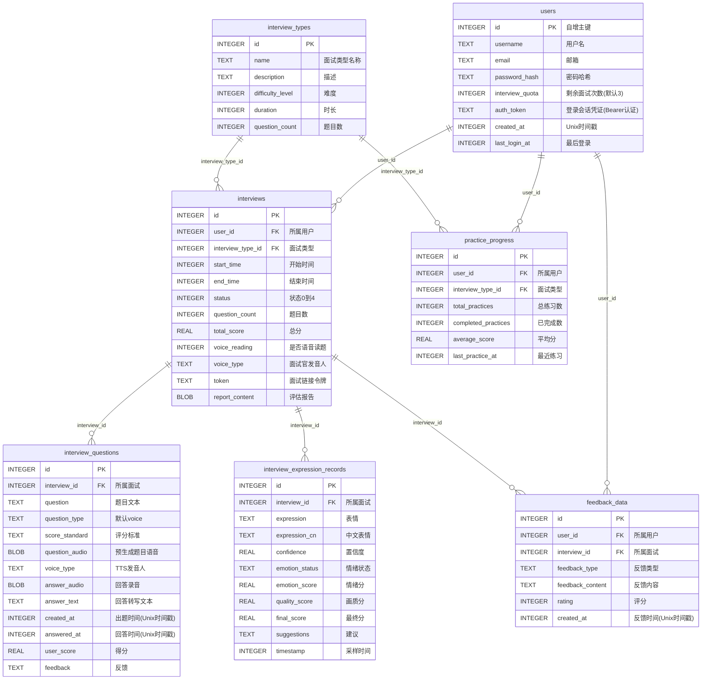

# AI智能面试系统

一个基于AI的自动化面试系统，能够根据候选人简历和岗位需求自动生成面试问题，支持在线语音面试，并能自动生成面试评估报告。

## 功能特点

- **智能面试问题生成**：基于候选人简历（核心依据）和目标岗位（定方向）自动生成针对性面试问题
- **在线语音面试**：候选人可通过网页进行语音回答，系统自动录音
- **自动面试评估**：系统自动分析面试表现，生成详细的面试评估报告，支持下载排版后的报告文件
- **模拟面试流程**：登录后上传简历、生成面试问题、在线作答到评估报告的完整闭环
- **表情识别（可选）**：面试页手动开启摄像头后，定期抓拍画面调用视觉模型分析情绪，聚合进面试报告（默认关闭）
- **多样化面试官音色**：提供多种面试官音色可选，题目自动预生成语音
- **智能语音合成**：集成阿里云百炼 Qwen-TTS 大模型，支持语音预生成，提升用户体验
- **支付功能**：支持套餐购买和增值服务，集成支付宝支付（默认关闭，可通过配置开启）
- **用户认证**：用户注册登录，登录后签发服务端会话 token（Bearer 认证），配额随用户记录管理

## 面试官音色

系统通过 `/api/tts/voices` 提供多种面试官音色，候选人在面试开始前可选择，选择结果保存在 `interviews.voice_type` 字段中：

| 音色类型               | 名称     | 说明                     |
| ---------------------- | -------- | ------------------------ |
| professional_male      | 专业男面试官 | 沉稳专业，适合技术岗位面试 |
| professional_female    | 专业女面试官 | 温柔专业，适合综合岗位面试 |
| friendly_male          | 亲和男面试官 | 阳光友好，营造轻松氛围     |
| friendly_female        | 亲和女面试官 | 活泼亲切，缓解紧张感       |
| strict_male            | 严谨男面试官 | 严肃认真，适合技术深挖     |
| strict_female          | 严谨女面试官 | 干净利落，专业严谨         |

### 使用说明

1. 面试官音色在**进入面试页后选择**，可通过朗读开关旁的设置随时切换（`/api/interview/{token}/set_voice`）
2. 出题内容由「简历分析结果 + 目标岗位」驱动，音色只影响朗读发音，不影响题目内容与评估结论
3. 实际合成走 Qwen-TTS，音色映射为：专业男 → Ethan，专业女 → Cherry，其余类型回落到默认音色 Cherry（详见下方「语音合成功能」）

## 系统架构

- **后端**：基于Python和FastAPI的RESTful API服务（uvicorn 启动，/docs 接口文档使用本地静态 swagger-ui 资源，离线可用）
- **认证**：服务端会话 token——登录成功生成随机 token 存入 `users.auth_token`，前端凭 `Authorization: Bearer <token>` 请求头访问需要身份的接口，不信任前端传参
- **前端**：使用Vue.js 3和Bootstrap 5构建的响应式Web界面（Vue/axios 均为本地文件，不依赖 CDN）
- **数据库**：使用SQLite进行数据存储（单文件，线程本地连接池）
- **AI模型**：集成阿里云百炼大语言模型（OpenAI 兼容接口），出题/报告/答题提示统一使用 `LLM_MODEL`（默认 qwen-flash），表情识别使用 `VISION_MODEL`（默认 qwen3-vl-flash）
- **语音处理**：支持Web录音，语音识别使用 `ASR_MODEL`（默认 paraformer-v2）
- **语音合成**：集成阿里云百炼 Qwen-TTS 大模型（`TTS_MODEL`，默认 qwen-tts），支持语音预生成
- **支付系统**：支持支付宝支付与模拟支付，提供套餐购买（`PAYMENT_ENABLED` 默认关闭）

## 项目结构

```
project-interview/
├── app/                                  # 主应用目录
│   ├── ai_services/                      # 智能体服务层
│   │   ├── expression_service.py         # 表情分析服务
│   │   ├── prompt.py                     # 面试提示词模板
│   │   ├── question_service.py           # 面试问题生成服务（LLM_MODEL，与报告同模型）
│   │   ├── report_service.py             # 面试报告生成服务（LLM_MODEL，与出题同模型）
│   │   ├── resume_parser.py              # pdf解析服务（MinerU 主路径，pypdf 降级）
│   │   ├── resume_service.py             # 简历信息提取服务
│   │   └── speech_service.py             # 语音处理服务
│   ├── api/                              # API层
│   │   ├── auth_api.py                   # 用户认证API（注册/登录/登出/配额）
│   │   ├── deps.py                       # 认证依赖（get_auth_user：解析 Bearer token 确定当前用户）
│   │   ├── expression_api.py             # 表情分析API
│   │   ├── interview_api.py              # 面试管理API
│   │   ├── order_api.py                  # 订单管理API
│   │   ├── payment_api.py                # 支付回调API
│   │   ├── pricing_api.py                # 套餐定价API
│   │   ├── report_api.py                 # 面试报告生成API
│   │   ├── resume_api.py                 # 简历上传API（个人版开始面试的唯一入口）
│   │   └── tts_api.py                    # 语音合成API
│   ├── config/                           # 配置管理
│   │   └── config.py                     # 配置文件（AI 模型/端点等全部集中于此，支持 .env 覆盖）
│   ├── db/                               # 数据库模块
│   │   ├── db.py                         # 数据库连接管理
│   │   ├── db_pool.py                    # 数据库连接池（threading.local 线程本地池）
│   │   ├── create_personal_interview_system_db.py # 建表脚本（权威来源：个人版7表+支付表）
│   │   └── interview_system.db           # SQLite数据库文件
│   ├── static/                           # 静态前端文件
│   │   ├── admin.html                    # 工作台界面（登录后上传简历、查看面试记录）
│   │   ├── interview.html                # 候选人面试界面
│   │   ├── record_detail.html            # 面试记录详情页（题目/回答/报告回看）
│   │   ├── login.html                    # 登录界面
│   │   ├── register.html                 # 注册界面
│   │   ├── pricing.html                  # 套餐购买界面
│   │   ├── swagger-ui/                   # swagger-ui 本地静态资源（/docs 离线可用）
│   │   ├── css/                          # 样式文件
│   │   └── js/                           # JavaScript库（Vue/axios 本地文件 + report_download.js 报告下载工具）
│   ├── utils/                            # 工具函数
│   │   └── utils.py                      # 通用工具函数
│   ├── temp/                             # 临时文件目录（简历解析时自动创建，用后自动清理）
│   ├── logs/                             # 运行日志目录（server 启动后生成 app.log）
│   ├── server.py                         # 旧版 Flask 入口（已退役，仅作对照参考，不保证可运行）
│   ├── main.py                           # FastAPI版入口（现役，uvicorn 启动，端口 10009）
│   ├── payment_module.py                 # 支付功能模块
│   ├── minimal_test.py / simple_test.py  # 简单测试脚本（开发调试用）
│   └── alipay_module.py                  # 支付宝集成模块
├── tests/                                # 测试脚本目录
│   ├── ai_api_check.py                   # AI 接口连通性测试（含百炼配额诊断与多模态真实调用）
│   ├── full_healthcheck.py               # 系统全量健康检查
│   ├── test_quota_gate.py                # 配额拦截测试
│   └── full_flow_test.py                 # 全流程测试（未被 git 跟踪）
├── docs/                                 # 文档目录（开发教程、图片资源、实验notebook、示例简历）
├── dailylogs/                            # 开发日志（每日总结、技术学习笔记、项目教程）
├── .env                                  # 环境变量配置（API密钥，不提交git）
├── .env.example                          # 环境变量配置模板（配置项说明与默认值，随 git 提交）
├── .dockerignore                         # Docker构建排除名单（防止venv/.env/数据库进镜像）
├── docker/                               # Docker部署全家桶（Dockerfile、docker-compose.yml、nginx配置与SSL证书）
├── start_server.bat / start_server.ps1   # Windows启动脚本
├── start_personal_server.bat             # 个人版启动脚本
├── start_server_background.bat           # 后台静默启动脚本
├── requirements.txt                      # Python依赖包列表
├── resume.md                             # 简历解析结果示例
├── .gitignore                           # Git忽略文件
└── README.md                             # 项目说明文档
```

## 数据库设计

系统使用 SQLite 数据库（单文件 `interview_system.db`），包含 **7 张核心业务表 + 6 张支付扩展表**，核心表关系均为 **1:N 外键**，无多对多中间表。下方 ER 图展示核心业务表。

### ER 图



### 表说明

**链路一：面试主流程** —— 一场完整面试的数据流

| 表名                                 | 说明                                   | 核心字段                                                                                  |
| ---------------------------------- | ------------------------------------ | ------------------------------------------------------------------------------------- |
| **users**                          | 用户表（含面试配额与会话凭证）                | id, username, email, password\_hash, interview\_quota, auth\_token                     |
| **interview\_types**               | 面试类型字典表（类型名称、难度、时长、题目数）              | id, name, difficulty\_level, duration, question\_count                                |
| **interviews**                     | 核心表：一场面试 = 一条记录（谁面的、面的哪类、状态、总分、面试令牌） | id, user\_id, interview\_type\_id, status, token, total\_score, report\_content(BLOB) |
| **interview\_questions**           | 每道题：题目文本、预生成语音、回答录音/转写、得分与反馈         | id, interview\_id, question, question\_audio(BLOB), answer\_text, user\_score         |
| **interview\_expression\_records** | 表情分析采样记录：情绪、置信度、各项评分、建议              | id, interview\_id, expression, emotion\_status, final\_score                          |

**链路二：练习统计与反馈**

| 表名                     | 说明                         | 核心字段                                                                    |
| ---------------------- | -------------------------- | ----------------------------------------------------------------------- |
| **practice\_progress** | 每个用户 × 每种面试类型一条，累计练习次数与平均分 | id, user\_id, interview\_type\_id, completed\_practices, average\_score |
| **feedback\_data**     | 用户对面试的反馈评价                 | id, user\_id, interview\_id, feedback\_type, rating                     |

### 设计说明

1. **时间字段统一存 Unix 时间戳**（`INTEGER`，默认 `strftime('%s','now')`），不是日期字符串
2. **外键默认不强制**：建表语句虽声明了 `FOREIGN KEY`，但 SQLite 需要连接时执行 `PRAGMA foreign_keys = ON` 才会真正校验
3. 支付相关表（`user_quotas`、`pricing_plans`、`orders` 等 6 张）定义已并入 `create_personal_interview_system_db.py`，程序启动时由 `init_db()` 自动创建，并含 `users` 表的 `phone/user_type/status` 迁移补列；旧版企业版的 `positions`、`candidates` 表已彻底清理（数据库无表、代码无引用）
4. 查看/管理数据库可使用 DB Browser for SQLite 或 Navicat Premium（连接类型选择 SQLite → 现有数据库文件）

## 面试状态流转

```
状态0: 未开始 ──[问题生成服务]──► 状态1: 试题已备好 ──[候选人开始]──► 状态2: 面试进行中
                                                                        │
                                                                        │ 完成所有问题
                                                                        ▼
状态4: 面试报告已生成 ◄──[报告生成服务]── 状态3: 面试完毕
```

## 快速启动指南

### 第一步：进入项目目录

```bash
cd project-interview
```

### 第二步：安装依赖

**使用虚拟环境（项目已内置** **`app\venv`，Python 3.13）**

```bash
# 创建虚拟环境（如 app\venv 已存在可跳过）
python -m venv app/venv

# 激活虚拟环境
# Windows:
app\venv\Scripts\activate
# Linux/Mac:
source app/venv/bin/activate

# 安装依赖
pip install -r requirements.txt
```

### 第三步：配置API密钥

在项目根目录下创建 `.env` 文件（已存在可跳过；完整配置项说明和默认值参考 `.env.example` 模板，模板中不含真实密钥）：

```env
DASHSCOPE_API_KEY=你的百炼API密钥
# 以下为可选配置，不写则使用 config.py 中的默认值
# LLM_MODEL=qwen-flash          # 出题/报告/提示 共用文本模型
# VISION_MODEL=qwen3-vl-flash   # 表情识别视觉模型
# TTS_MODEL=qwen-tts            # 语音合成模型
# ASR_MODEL=paraformer-v2       # 语音识别模型
```

> 本项目使用阿里云百炼大模型，需要申请API Key: <https://dashscope.console.aliyun.com/>

### 第四步：初始化数据库

```bash
# 表结构已集中到一个脚本（个人版7表+支付表），程序启动时 init_db() 也会自动执行
python app\db\create_personal_interview_system_db.py
```

### 第五步：启动服务

**仅需要启动1个服务（所有功能已集成到 main.py，FastAPI + uvicorn）：**

```bash
app\venv\Scripts\python.exe -m app.main
```

（或直接双击 start_server.bat）

### 第六步：访问系统

启动成功后，打开浏览器访问（建议用 127.0.0.1 而非 localhost，避免被解析为 IPv6 导致连接失败；必须通过 http 访问，双击 html 文件用 file: 协议打开会请求失败）：

- **工作台**：<http://127.0.0.1:10009/static/admin.html>（根路径 `/` 也返回此页；登录后上传简历开始面试、查看历史记录）
- **登录界面**：<http://127.0.0.1:10009/static/login.html>
- **注册界面**：<http://127.0.0.1:10009/static/register.html>
- **面试界面**：<http://127.0.0.1:10009/static/interview.html?token=xxx>（token 由上传简历后自动创建）
- **记录详情**：从工作台的面试记录列表进入（回看题目、回答与报告）
- **套餐购买**：<http://127.0.0.1:10009/static/pricing.html>（支付功能默认关闭，开启后才可访问）
- **接口文档**：<http://127.0.0.1:10009/docs>（swagger-ui 本地静态资源版，可在线调试全部 API）

### Docker 部署（可选）

部署文件集中在 `docker/` 目录（Dockerfile、docker-compose.yml、nginx 配置与 SSL 证书），容器内监听 10009 端口：

```bash
cd docker
docker compose up -d --build
```

说明：构建上下文为仓库根目录（compose 中 `context: ..`），Dockerfile 会安装 Pango 系统库以支持 WeasyPrint 生成 PDF 报告；nginx 反向代理到 app 容器的 10009 端口。`.dockerignore` 已排除 venv、.env、数据库文件等，不会被打进镜像。

***

## 详细安装指南

### 环境要求

- Python 3.10+
- 现代浏览器（Chrome、Firefox、Edge等）

### 安装步骤详解

1. **进入项目目录**

```bash
cd project-interview
```

1. **创建并激活虚拟环境（可选）**

```bash
python -m venv venv
# Windows
venv\Scripts\activate
# Linux/Mac
source venv/bin/activate
```

1. **安装依赖包**

```bash
pip install -r requirements.txt
```

1. **配置环境变量**

在项目根目录下创建`.env`文件（配置项说明参考 `.env.example`）：

```env
DASHSCOPE_API_KEY=your_api_key_here
```

1. **初始化数据库**

```bash
python app\db\create_personal_interview_system_db.py
```

## 使用说明

### 启动系统服务

1. **启动Web服务器**

```bash
app\venv\Scripts\python.exe -m app.main
```

### 访问地址

- **工作台**：<http://127.0.0.1:10009/static/admin.html>（根路径 `/` 同样返回此页）
- **登录界面**：<http://127.0.0.1:10009/static/login.html>
- **注册界面**：<http://127.0.0.1:10009/static/register.html>
- **面试界面**：<http://127.0.0.1:10009/static/interview.html?token=xxx>（token 由上传简历后自动创建）
- **记录详情**：从工作台的面试记录列表进入

### 系统流程

1. 用户注册/登录账号（登录成功后前端保存会话 token，后续请求通过 `Authorization: Bearer` 头携带）
2. 新用户默认获得 3 次面试配额（`users.interview_quota`）
3. 在工作台上传简历（PDF，必填目标岗位——出题方向由岗位决定，简历分析结果才是出题核心依据）
4. 系统解析简历（MinerU 主路径，失败自动降级 pypdf）→ AI 出题（约 2 分钟）→ 自动创建面试并跳转
5. 出题完成时自动预生成题目语音（Qwen-TTS）
6. 候选人在面试页作答（语音录音或文字），可选开启摄像头进行表情分析（默认关闭，手动开启）
7. 面试完成后，系统生成评估报告，可在工作台/详情页查看并下载排版后的报告文件
8. 每场「大模型成功出题」的面试扣 1 次配额；配额用完后可购买套餐继续使用（支付功能默认关闭）

## API接口说明

标注「认证」的接口需要在请求头携带 `Authorization: Bearer <登录token>`，未登录返回 401。

### 认证与配额

| API端点                | 方法   | 功能                               | 认证 |
| ---------------------- | ---- | ---------------------------------- | ---- |
| `/api/auth/register`   | POST | 用户注册                           | -    |
| `/api/auth/login`      | POST | 用户登录（返回会话 token）          | -    |
| `/api/auth/logout`     | POST | 退出登录（服务端销毁 token）        | 认证 |
| `/api/user/quota`      | GET  | 查询当前用户面试配额               | 认证 |

### 简历与面试主流程

| API端点                                  | 方法   | 功能                                     | 认证 |
| ---------------------------------------- | ------ | ---------------------------------------- | ---- |
| `/api/resume/upload`                     | POST   | 上传简历并分析，创建面试（唯一入口）     | 认证 |
| `/api/interview/{token}/info`            | GET    | 获取面试信息                             | -    |
| `/api/interview/{token}/get_question`    | GET    | 获取下一题                               | -    |
| `/api/interview/{token}/submit_text_answer` | POST | 提交回答（语音转写文本）                 | -    |
| `/api/interview/{token}/toggle_voice_reading` | POST | 切换语音朗读                            | -    |
| `/api/interview/{token}/set_voice`       | POST   | 设置面试官音色                           | -    |
| `/api/interview/{token}/generate_questions` | POST | （重新）生成面试问题                     | -    |
| `/api/interview/{token}/hint`            | POST   | AI 辅助：生成当前题目答题思路提示        | -    |
| `/api/interview/{token}/detail`          | GET    | 查询某场面试完整详情（题目+回答+报告）   | -    |
| `/api/interview/my_records`              | GET    | 查询当前用户面试记录列表（工作台用）     | 认证 |
| `/api/interview/stats`                   | GET    | 面试统计（总数+状态分布）                | -    |
| `/api/evaluation/generate`               | POST   | 生成面试评估报告                         | -    |

### 表情分析（可选功能，默认关闭）

| API端点                                    | 方法   | 功能                       | 认证 |
| ------------------------------------------ | ------ | -------------------------- | ---- |
| `/api/expression/analyze`                  | POST   | 分析抓拍画面的表情/情绪    | -    |
| `/api/interview/{token}/expression`        | POST   | 保存面试表情采样记录       | -    |
| `/api/interview/{token}/expression_report` | GET    | 获取表情分析聚合报告       | -    |

### 语音合成

| API端点                | 方法   | 功能                     | 认证 |
| ---------------------- | ------ | ------------------------ | ---- |
| `/api/tts/voices`      | GET    | 获取面试官音色列表       | -    |
| `/api/tts/synthesize`  | POST   | 合成语音（base64 音频）  | -    |

### 套餐与支付（支付功能默认关闭）

| API端点                            | 方法   | 功能                     | 认证 |
| ---------------------------------- | ------ | ------------------------ | ---- |
| `/api/pricing/plans`               | GET    | 获取套餐列表             | -    |
| `/api/pricing/plans/{plan_id}`     | GET    | 获取套餐详情             | -    |
| `/api/orders/create`               | POST   | 创建订单                 | 认证 |
| `/api/orders/pay`                  | POST   | 支付订单（含模拟支付）   | 认证 |
| `/api/orders/{order_no}/status`    | GET    | 查询订单状态             | -    |
| `/api/orders/user/{user_id}`       | GET    | 查询用户订单             | -    |
| `/api/payment/alipay/notify`       | POST   | 支付宝异步通知           | -    |
| `/api/payment/alipay/return`       | GET    | 支付宝同步返回           | -    |
| `/api/payment/mock/confirm`        | POST   | 模拟支付确认（开发用）   | -    |

> 完整参数与响应结构以 `/docs`（swagger-ui）实时生成的 OpenAPI 文档为准。

## 主要脚本说明

| 文件名                                        | 功能描述                               |
| ------------------------------------------ | ---------------------------------- |
| main.py                                    | FastAPI Web服务器，提供RESTful API（包含所有功能，现役入口） |
| server.py                                  | 旧版 Flask 入口（已退役，仅作对照参考）             |
| payment\_module.py                         | 支付功能模块，用户认证、配额管理、套餐管理、订单管理         |
| alipay\_module.py                          | 支付宝集成模块，支持网页支付、扫码支付、订单查询、模拟支付      |
| create\_personal\_interview\_system\_db.py | 建表脚本（权威来源：个人版7表+支付表，启动时自动执行）       |

## 核心模块说明

| 模块名      | 功能描述                               | 文件位置                                    |
| -------- | ---------------------------------- | --------------------------------------- |
| 认证依赖    | 从 Bearer 请求头解析当前用户（未登录返回 401）  | app/api/deps.py                         |
| 用户认证API | 注册/登录/登出/配额查询                     | app/api/auth\_api.py                    |
| 简历上传API | 上传简历、解析分析、创建面试（开始面试唯一入口） | app/api/resume\_api.py                  |
| 面试管理API  | 管理面试流程                             | app/api/interview\_api.py               |
| 面试报告API  | 生成面试评估报告                           | app/api/report\_api.py                  |
| 表情分析API  | 抓拍画面情绪分析与聚合报告                  | app/api/expression\_api.py              |
| 数据库连接管理  | 管理数据库连接                            | app/db/db.py                            |
| 数据库连接池   | 线程本地连接池（每线程一个连接）              | app/db/db\_pool.py                      |
| 表情分析服务   | 调用视觉模型分析面试者表情（qwen3-vl-flash）   | app/ai\_services/expression\_service.py |
| 面试问题生成服务 | 生成面试问题（LLM_MODEL，与报告同模型）    | app/ai\_services/question\_service.py   |
| 面试提示词模板  | 简历为核心依据、岗位定方向的出题提示词         | app/ai\_services/prompt.py              |
| 面试报告生成服务 | 生成面试报告（LLM_MODEL）              | app/ai\_services/report\_service.py     |
| 简历解析服务   | PDF 转 Markdown（MinerU，失败降级 pypdf）  | app/ai\_services/resume\_parser.py      |
| 简历分析服务   | 分析简历内容                             | app/ai\_services/resume\_service.py     |
| 语音处理服务   | 语音识别（paraformer-v2）与语音合成（qwen-tts） | app/ai\_services/speech\_service.py     |
| 工具函数     | 通用工具函数                             | app/utils/utils.py                      |

## 语音合成功能

系统集成阿里云百炼 Qwen-TTS 大模型（`TTS_MODEL`，默认 qwen-tts）进行语音合成，支持以下功能：

### 音色说明

Qwen-TTS 仅支持英文别名音色（不认 zh-CN-* 风格音色）。系统维护「面试官音色类型 → Qwen-TTS 音色」的映射表，未命中映射时回落到默认音色：

| 音色ID   | 性别 | 说明                       |
| -------- | ---- | -------------------------- |
| Ethan    | 男   | 专业男面试官的实际发音音色 |
| Cherry   | 女   | 默认音色（专业女面试官等回落到此） |
| Chelsie  | 女   | 温柔女声                   |

> 音色映射关系定义在 `app/ai_services/speech_service.py` 的 `VOICE_MAP`，默认音色由 `DEFAULT_TTS_VOICE` 配置。

### 调用方式

1. **请求端点**：Qwen-TTS 走 DashScope 原生 multimodal-generation 端点（不是旧版 /audio/tts）
2. **返回形式**：非流式调用返回的是 24 小时有效的音频下载地址，服务端会二次下载二进制后返回给调用方
3. **降级机制**：模型额度不足或调用失败时，接口返回 `use_browser_tts=True` 提示前端改用浏览器内置语音合成

### 语音预生成

为了提升用户体验，系统在生成面试问题时会自动预生成语音：

1. **预生成时机**：生成面试问题时，立即调用TTS API合成语音
2. **存储方式**：语音数据以BLOB格式存储在数据库的`question_audio`字段
3. **使用方式**：获取问题时直接返回预生成的语音，无需等待实时合成
4. **回退机制**：如果预生成失败，系统会自动回退到实时合成

## 支付系统

系统支持套餐购买，支付功能由 `PAYMENT_ENABLED` 开关控制（默认关闭，关闭时 `/api/pricing/plans` 返回 503）：

### 配额模型

- 个人版唯一配额项为 `users.interview_quota`（注册默认 3 次面试）
- 支付成功后同步更新 `users.interview_quota`，实时生效

### 支付方式

- **支付宝**：支持网页支付（需配置支付宝SDK和商户信息）
- **模拟支付**：开发环境下使用模拟支付确认接口，无需真实支付

## 注意事项

1. **API密钥配置**：需要在项目根目录的`.env`文件中配置正确的 API 密钥（配置项说明参考 `.env.example`，模板中不含真实密钥）；AI 模型名/端点等全部集中在 `app/config/config.py`，均可通过 .env 覆盖
2. **语音识别**：系统使用Web录音API收集答案，语音转写使用阿里云百炼 paraformer-v2 模型（`ASR_MODEL`）
3. **语音合成**：使用阿里云百炼 Qwen-TTS 模型（`TTS_MODEL`），需要配置 DASHSCOPE\_API\_KEY；额度不足时自动降级为浏览器内置语音合成
4. **语音预生成**：生成问题时自动预生成语音，提升面试时的用户体验
5. **表情识别**：可选功能，默认关闭；需在面试页手动点击「开启摄像头」授权后才会抓拍分析，分析失败不影响答题与报告
6. **PDF处理**：系统使用本地 MinerU（GPU 加速）将 PDF 简历解析为 Markdown，保留排版/表格信息；MinerU 不可用或解析失败时自动降级为 pypdf 纯文本提取。MinerU 首次运行需下载 1-2GB 模型权重
7. **浏览器兼容性**：面试界面使用MediaRecorder API，推荐使用Chrome、Firefox、Edge等现代浏览器
8. **支付系统**：默认关闭；生产环境需要配置支付宝SDK和商户信息
9. **后台任务**：出题等后台任务在进程内存中执行，服务器重启/崩溃会导致进行中的任务丢失

## 技术依赖

| 类别      | 技术                                   |
| ------- | ------------------------------------ |
| Web框架   | FastAPI + uvicorn（2026-09 从 Flask 迁移） |
| 前端框架    | Vue.js 3                             |
| UI组件    | Bootstrap 5                          |
| AI模型    | 阿里云百炼 qwen-flash（出题/报告/提示，统一走 LLM_MODEL）+ qwen3-vl-flash（表情识别，VISION_MODEL） |
| 语音合成    | 阿里云百炼 Qwen-TTS（TTS_MODEL）            |
| 语音识别    | 阿里云百炼 paraformer-v2（ASR_MODEL）       |
| 支付系统    | 支付宝SDK                               |
| 数据库     | SQLite                               |
| PDF生成   | WeasyPrint                           |
| PDF解析   | MinerU 2.7.6（本地 GPU，主路径）+ pypdf（降级）  |
| HTTP客户端 | OpenAI SDK / httpx / requests        |

## 开发与扩展

系统采用模块化设计，可根据需要进行扩展：

- 集成不同的AI模型服务商
- 添加更多面试问题类型
- 扩展面试评估维度
- 添加视频面试功能
- 集成企业微信/钉钉通知
- 添加更多支付方式

## 版权声明

© 2026 \[作者姓名/申请主体名称] 保留所有权利（All Rights Reserved）。

本项目为商业项目，代码仅以学习交流为目的对外展示，供他人参考。未经作者书面授权，不得以任何形式将本项目全部或部分代码用于商业用途、二次分发或申请其他软件著作权。

> 说明：本项目在运行时通过命令行方式调用开源工具 MinerU 进行 PDF 解析，不包含、也未修改其源代码；除此之外全部代码均为原创开发。

