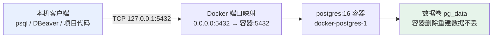

# PostgreSQL 连接与使用笔记

> 2026-10-08 记录：项目数据库已从 SQLite 迁移到 PostgreSQL 16（Docker 容器部署）。
> 本文回答一个核心问题：**怎么建立到项目数据库的连接**。

## 一、连接五要素

不管用什么工具连（命令行 / GUI / 代码），都需要这 5 个参数：

| 参数 | 值 | 说明 |
|---|---|---|
| host | `127.0.0.1` | 容器把 5432 端口映射到了本机 |
| port | `5432` | PG 默认端口 |
| user | `zsmian` | 首次启动容器时自动创建的超级用户 |
| password | 看 `docker/.env` | `POSTGRES_PASSWORD` 变量的值（不入 git） |
| database | `interview_system` | 首次启动时自动创建的库 |



关键理解：**PG 跑在容器里，本机程序连的是"本机的 5432 端口"，由 Docker 把流量转发进容器**。所以 host 永远填 `127.0.0.1`，不需要知道容器内网 IP。

## 二、方式 1：容器内 psql（零安装，推荐入门）

本机没装 PG 也没关系——容器里自带 psql 客户端，用 `docker exec` 进去执行：

```powershell
# 交互式进入（能敲多条命令，exit 退出）
docker exec -it docker-postgres-1 psql -U zsmian -d interview_system

# 单条执行（不进入交互，跑完即出）
docker exec docker-postgres-1 psql -U zsmian -d interview_system -c "SELECT COUNT(*) FROM users;"
```

容器内本地连接不需要输密码（PG 对容器内 local 连接默认信任），这也是它最省事的原因。

### psql 常用命令速查

| 命令 | 作用 |
|---|---|
| `\dt` | 列出所有表 |
| `\d 表名` | 看表结构（字段、类型、约束） |
| `\l` | 列出所有数据库 |
| `\dn` | 列出 schema |
| `\timing` | 开关每条 SQL 的耗时显示 |
| `\x` | 切换纵向显示（宽表必备） |
| `\q` | 退出 psql |
| `\?` | 全部元命令帮助 |

注意：`\dt` 这类反斜杠命令是 psql 自己的"元命令"，不是 SQL；真正的 SQL 要以分号 `;` 结尾才执行。

## 三、方式 2：GUI 工具（DBeaver / Navicat / DBCode）

适合日常看数据、改数据。以免费的 **DBeaver** 为例：

1. 新建连接 → 选 PostgreSQL
2. 按上面的连接五要素填：host `127.0.0.1`、port `5432`、库 `interview_system`、用户 `zsmian`、密码从 `docker/.env` 抄
3. 首次连接会提示下载驱动，点确认即可
4. 若提示 SSL，把 SSL 模式设为 `disable`（本机容器连接没配证书）

Trae 里的 **DBCode 插件**同理（注意：本机没装 Node.js，DBCode 的 MCP/CLI 功能用不了，但纯连接看表没问题；首次连库要手动下载驱动）。

## 四、方式 3：代码里连接（项目已封装，业务代码不用关心细节）

项目统一走 `app/db/db_pool.py` 的连接池，业务代码只 import 两个函数：

```python
from app.db.db import get_db, return_db

conn = get_db()          # 从池里借一个连接
try:
    row = conn.execute(
        'SELECT id, username FROM users WHERE id = %s', (29,)
    ).fetchone()          # psycopg 配了 dict_row：返回字典，按列名取值
    print(row['username'])
finally:
    return_db(conn)      # 用完必须归还（借了不还池子会枯竭）
```

两个和 SQLite 时代的关键差异：

1. **占位符**：SQLite 用 `?`，psycopg3 用 `%s`，参数放在元组里传入（防 SQL 注入的标准姿势）
2. **事务**：写操作（INSERT/UPDATE/DELETE）后要 `conn.commit()`；读操作不用。池子默认 autocommit=false，不 commit 的话别人看不到你的修改

连接信息从哪来：`config.py` 读 `.env` 的 `DATABASE_URL`（格式 `postgresql://用户名:密码@主机:5432/库名`）；`.env` 不配则回退 SQLite。容器部署时由 docker-compose 的 environment 覆盖为 `postgres:5432`（容器内网域名）。

## 五、常见坑

| 症状 | 原因与解法 |
|---|---|
| `Connection refused` | 容器没起：`docker ps` 看状态，没起就 `docker compose up -d postgres` |
| `password authentication failed` | 密码错：去 `docker/.env` 抄 `POSTGRES_PASSWORD` |
| `database "interview_system" does not exist` | 连错库/连错端口（5432 被别的 PG 占了） |
| GUI 连不上但 docker exec 能连 | 检查 host 是不是填了 `postgres`——那是容器内网域名，只有容器之间能用，本机要填 `127.0.0.1` |
| 表里中文乱码 | PG 默认 UTF-8 一般不会乱；乱的多半是终端编码，PowerShell 先跑 `chcp 65001` |
| 改了表结构不生效 | PG 没有自动迁移，改 `create_personal_interview_system_db.py` 后要删卷重建或手动 ALTER |
