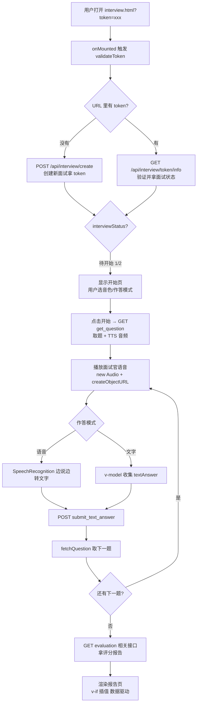

# 前端学习笔记（6 小时速成版 · 结合 AI 面试官项目）

> 定位：6 小时达到"**看懂项目前端 70% + 能做小修改 + 会前后端联调**"。
> 不做前端工程师，音频/流式等高级部分砍掉，用到再查（见文末"跳过清单"）。
> 所有代码示例取自 `app/static/interview.html` 真实代码，注释同时解释"做了什么"和"语法本身"。

***

## 6 小时执行表

| 时间   | 学什么     | 动手任务                                                                           | 对应章节  |
| ---- | ------- | ------------------------------------------------------------------------------ | ----- |
| 1.5h | JS 语法映射 | 打开 `interview.html` 的 `setup()`（约 1552 行），把变量声明和函数逐个翻译成 Python 心智模型，翻译完 10 个为止 | 第 3 节 |
| 1.5h | Vue 三件套 | 在模板里找出 `v-if`、`v-model`、`@click` 各 3 处，一句话说出每处在干什么                             | 第 4 节 |
| 1.5h | 前后端对接   | 走通一条链路：前端 `submitAnswer`（约 2570 行）→ 后端 `submit_text_answer` → 返回 JSON → 前端怎么用  | 第 5 节 |
| 1.5h | F12 实战  | ① Network 面板完整看一次"提交答案"请求；② 改一处页面文字或加一个 `console.log`，刷新验证生效                   | 第 7 节 |

执行要点：**1\~2 天内连续完成**（拆成一周每天半小时等于没学）；**卡住就跳**，标记后回查，目标是建立索引而不是背语法。

***

## 1. 项目前端全景图（10 分钟速览）

前端全部是**单文件 HTML 页面**，在 `app/static/` 目录，由 FastAPI 直接托管——访问 `http://127.0.0.1:10009/interview.html` 就能拿到这个文件。

| 文件                             | 作用                       | 用到的技术                         |
| ------------------------------ | ------------------------ | ----------------------------- |
| `login.html` / `register.html` | 登录、注册                    | 最简单，表单 + axios                |
| `interview.html`               | **核心页面**：面试全流程（约 3000 行） | Vue 3 + axios + 浏览器音频/摄像头 API |
| `admin.html` / `pricing.html`  | 管理后台、付费页                 | Vue 3 + axios                 |

支撑页面的第三方库（`app/static/js/` 本地文件，不依赖 CDN）：

| 库                    | 干什么的         | 类比后端                |
| -------------------- | ------------ | ------------------- |
| `vue.global.prod.js` | 数据变了页面自动更新   | 浏览器里的"模板渲染引擎"       |
| `axios.min.js`       | 发 HTTP 请求调后端 | Python 的 `requests` |
| `bootstrap.min.css`  | 现成按钮/卡片/表单样式 | 界面脚手架，不用自己写样式       |
| `sweetalert2.js`     | 好看的弹窗        | 纯 UI 工具             |

> 本项目**没有 npm / Vite / 打包**——前端只是展示层，页面少，无构建模式部署最简单：FastAPI 把 `app/static/` 托管出去就完事。

***

## 2. 前端三件套：一句话版

```
HTML → 骨架：页面上有什么    （名词）
CSS  → 皮肤：内容长什么样    （形容词，本项目靠 Bootstrap，不用会写）
JS   → 肌肉：内容怎么动      （动词，项目前端 95% 的逻辑都是 JS）
```

各看一个真实例子（都在 `interview.html` 里）：

```html
<!-- HTML：一对标签 + 属性。<textarea> 是多行文本输入框 -->
<!-- class="form-control" 挂 Bootstrap 样式；placeholder 是灰色提示文字 -->
<textarea v-model="textAnswer" class="form-control" rows="5"
          placeholder="请输入你的答案..."></textarea>
<!-- 注意：v-model 不是 HTML 原生属性，是 Vue 指令（第 4 节讲） -->
```

```css
/* CSS：选择器 { 属性: 值; }。开头的 . 表示按 class 匹配 */
/* 只需认识：HTML 里 class="error-message" 的元素会应用这条样式 */
.error-message { background: rgba(239, 68, 68, 0.1); color: #ef4444; }
```

```js
// JS：这一行把 error 变量设为错误文字。
// 因为页面上有 <div v-if="error">，所以这一行一执行，错误提示框自动出现
error.value = '提交答案失败，请刷新页面重试';
```

记住分工即可，下面全部时间给 JS 和 Vue。

***

## 3. 【第 1 个 1.5h】JavaScript 语法速成

对着 Python 讲，只挑项目代码里实际出现的语法。

### 3.1 变量声明：`const` 和 `let`

```js
// JS 必须先声明再用（Python 直接 x = 1，JS 不行）
// const：声明后不能重新赋值
// let  ：普通变量，可以重新赋值
const baseURL = 'http://127.0.0.1:10009/';   // 之后不能 baseURL = xxx
let recordingTime = 0;                        // 之后可以 recordingTime = 5

// 每行结尾习惯写分号 ;（不写大多能跑，但规范要求写）
```

### 3.2 函数：箭头函数 `=>`

```js
// Python: def fetch_question(): return xxx
// JS 的"箭头函数"（项目统一用这种）：
const fetchQuestion = async () => {   // () 是参数列表，=> 后面是函数体
    // ...
};
//      └── async 见 3.4

// 带参数（来自 playPreGeneratedAudio）：
const playPreGeneratedAudio = (audioBase64) => {
    // audioBase64 是传入参数，相当于 Python 的 def play(audioBase64):
};
```

### 3.3 模板字符串：反引号 + `${}`

```js
// Python: f"{baseURL}api/interview/{token.value}/info"
// JS: 用反引号 ` 包住字符串（键盘 Esc 下方那个键，不是单引号！），${} 里放变量
const response = await axios.get(`${baseURL}api/interview/${token.value}/info`);
```

> 读本项目代码最大的坑：`` ` ``（反引号）和 `'`（单引号）长得像但功能不同。看到 `${...}` 就是模板字符串。

### 3.4 异步：`async / await`（和 Python 几乎一样）

```js
// 项目真实代码（validateToken 函数）：
const validateToken = async () => {           // async 标记异步函数
    try {
        const response = await axios.get(`${baseURL}api/interview/${token.value}/info`);
        //                 ↑ await = 在这一行"等结果出来再往下走"
        console.log('token有效:', response.data);   // response.data 是后端返回的 JSON
    } catch (err) {                            // try/catch ≈ Python 的 try/except
        console.error('token无效:', err);
    }
};

// Python 心智模型：
//   async def validate_token():
//       try: response = await axios_get(...)
//       except Exception as err: print(err)
```

要点：

- `axios.get(...)` 立刻返回"任务单"（Promise），`await` 负责等它兑现。
- **不加 await**：代码不等接口返回就往下跑，拿到的是任务单不是数据——JS 新手第一大坑。

### 3.5 解构赋值（项目引入 Vue 的方式）

```js
// interview.html 第 1552 行：
const { createApp, ref, computed, onMounted } = Vue;
//     └──── 从 Vue 对象里"按名字掏出"这几个工具函数 ────┘

// 等价于 Python: from Vue import createApp, ref, computed, onMounted
// 也等价于逐行写: const createApp = Vue.createApp; ...
```

### 3.6 对象与数组（JSON 的本体）

```js
// 对象 = Python 的 dict（花括号 + 键值对，键可不加引号）
const interviewEvaluation = {
    averageScore: 76,
    scores: { professional: 80, communication: 68 }
};
// 取值：interviewEvaluation.averageScore 或 ['averageScore']

// 数组 = Python 的 list（方括号，下标从 0 开始）
const strengths = ['基础知识扎实', '专业技能突出'];
// 取值：strengths[0]；长度：strengths.length（= Python 的 len()）

// C 风格 for 循环（项目遍历识别结果处用到）：
// for (let i = 起始; i < results.length; ++i) { ... }
// 含义：i 从起始开始，每轮 +1，直到不超过长度-1
```

### 3.7 Python ↔ JS 对照表（核心索引）

| Python                | JavaScript                  | 项目里的例子                                |
| --------------------- | --------------------------- | ------------------------------------- |
| `x = 1`               | `let x = 1;`                | `let finalTranscript = '';`           |
| 常量约定 `X = 1`          | `const x = 1;`              | `const baseURL = ...`                 |
| `def f(a):`           | `const f = (a) => { ... };` | `const getTokenFromUrl = () => {...}` |
| `f"{a}b"`             | `` `${a}b` ``               | `` `${baseURL}api/...` ``             |
| `dict`                | object `{...}`              | `interviewEvaluation`                 |
| `list`                | array `[...]`               | `availableVoices`                     |
| `try/except`          | `try/catch`                 | 提交答案的完整包裹                             |
| `async def` + `await` | `async` + `await`           | 所有 axios 调用                           |
| `len(arr)`            | `arr.length`                | `event.results.length`                |
| `None`                | `null` / `undefined`        | `currentQuestion.value = null`        |

**动手任务**：打开 `interview.html`，从第 1552 行的 `setup()` 开始，把变量声明和函数逐个翻译成 Python 心智模型，翻译完 10 个为止。

***

## 4. 【第 2 个 1.5h】Vue 3 核心

Vue 解决的问题一句话：**页面显示 = 数据的函数。数据变了，显示自动跟着变。**

### 4.1 `ref`：让变量"有魔力"

```js
// 把普通变量变成"响应式变量"：数据变了，页面自动更新
const textAnswer = ref('');

// JS 代码里读写必须加 .value：
textAnswer.value = '我的答案';
```

关键规则（新手最容易混淆）：

- **JS 代码里**：必须写 `.value` → `textAnswer.value`
- **HTML 模板里**：直接写变量名，**不要** `.value` → `v-model="textAnswer"`
- 为什么：`ref` 是个带"监听器"的盒子，`.value` 是开门钥匙；模板里 Vue 自动帮你开门。

### 4.2 常用模板指令（项目里实际出现的全部）

```html
<!-- ① v-if：条件渲染。为真时这段 HTML 才出现在页面上 -->
<div v-if="!error && (interviewStatus >= 3)" class="completed-section">...</div>

<!-- ② v-model：双向绑定。输入框内容和 JS 变量实时同步 -->
<!-- 用户打字 → textAnswer.value 自动变；代码改它 → 输入框跟着变 -->
<textarea v-model="textAnswer" class="form-control" rows="5"></textarea>

<!-- ③ @click：点击事件 -->
<button class="camera-control-btn" @click="startCamera" v-if="!cameraActive">...</button>

<!-- ④ :class（冒号开头 = 属性值是 JS 表达式）：动态决定 CSS 类 -->
<!-- ?: 三目运算符 = Python 的 'a' if cond else 'b' -->
<i class="bi voice-icon"
   :class="isPlayingAudio ? 'bi-volume-up-fill text-primary'
          : (voiceReadingEnabled ? 'bi-volume-up' : 'bi-volume-mute')"></i>

<!-- ⑤ {{ }}：插值，把表达式的值显示在这里。|| 是"或"：有值显示值，为空显示提示 -->
<span>当前API基础路径: {{ baseURL || '(使用相对路径)' }}</span>
```

### 4.3 页面骨架：`createApp` + `setup` + `return`

`interview.html` 整个 JS 部分的骨架（已简化）：

```js
const { createApp, ref, computed, onMounted } = Vue;

createApp({
    setup() {                          // setup 是整个页面的"逻辑总入口"
        // ---- 1. 声明所有响应式数据 ----
        const textAnswer = ref('');
        const loading = ref(false);
        // ...(共 20 多个)

        // ---- 2. 定义所有函数（调接口、录音、播放等）----
        const fetchQuestion = async () => { /* ... */ };
        const submitAnswer = async () => { /* ... */ };

        // ---- 3. onMounted：页面加载完成后自动执行的"开机入口" ----
        onMounted(() => {
            validateToken();           // 从 URL 取 token → 验证 → 加载面试信息
        });

        // ---- 4. 把数据和函数"交还"给模板 ----
        // return 里列出的名字，HTML 里才能用（v-if="loading" 才认识 loading）
        return { textAnswer, loading, fetchQuestion, submitAnswer /* ... */ };
    }
}).mount('#app');    // 挂到 HTML 里 id="app" 的元素上
```

### 4.4 `computed`：由其他数据算出来的数据

```js
// 依赖的数据一变，它自动重算。等价 Python 的 @property
const isFinished = computed(() => currentQuestionIndex.value >= totalQuestions.value);
```

### 4.5 Vue 用法速查

| 你看到什么                      | 意思               |
| -------------------------- | ---------------- |
| `ref(x)` / `.value`        | 响应式变量 / 在 JS 中读写 |
| `v-if="条件"`                | 条件显示             |
| `v-model="变量"`             | 表单双向绑定           |
| `@click="函数"`              | 点击事件             |
| `:class` / `:src`          | 动态属性             |
| `{{ 表达式 }}`                | 显示数据             |
| `setup()` + `return {...}` | 页面逻辑入口           |
| `onMounted(() => {...})`   | 页面加载后执行          |
| `computed(() => ...)`      | 派生数据             |

**动手任务**：在 `interview.html` 模板里找出 `v-if`、`v-model`、`@click` 各 3 处，一句话说出每处在干什么。

***

## 5. 【第 3 个 1.5h】axios：前端怎么调后端接口

axios = 前端发 HTTP 请求的库，等同你后端测试用的 `requests`。

### 5.1 两种最常用的请求

```js
// GET：拿数据。后端对应 @router.get("/api/interview/{token}/info")
const response = await axios.get(`${baseURL}api/interview/${token.value}/info`);
const data = response.data;      // 后端返回的 JSON 在 response.data 里

// POST：提交数据。第二个参数是要发送的 JSON body
// 后端对应 @router.post("/api/interview/{token}/submit_text_answer")
const response = await axios.post(
    `${baseURL}api/interview/${token.value}/submit_text_answer`,
    {                            // ← 这个对象会被序列化成 JSON 发给后端
        question_id: questionId,
        answer_text: textAnswer.value
    }
);
// 后端 FastAPI 的参数字段名必须和这里对上（否则 422）
```

### 5.2 完整一次"提交答案"（把前两节全串起来）

`interview.html` 约 2570 行的真实代码，逐行翻译：

```js
try {
    const questionId = currentQuestion.value.id;   // .value 开盒子 → .id 取对象字段

    // 发 POST 提交答案（await 等后端处理完）
    const response = await axios.post(`${baseURL}api/interview/${token.value}/submit_text_answer`, {
        question_id: questionId,
        answer_text: textAnswer.value
    });

    await fetchQuestion();          // 提交成功后立刻拉取下一道题

    textAnswer.value = '';          // 清空输入框（v-model 双向绑定 → 页面自动清空）
    error.value = null;             // 清除错误提示（v-if="error" 的框自动消失）
} catch (err) {
    console.error('提交答案失败:', err);        // 打到浏览器控制台
    error.value = '提交答案失败，请刷新页面重试'; // 页面自动弹出错误提示
} finally {
    loading.value = false;          // 无论成败都关掉加载遮罩
}
```

注意整个过程中**没有一行"手动更新页面"的代码**——改数据，页面自动变，这就是 Vue 的价值。

### 5.3 baseURL：本地/线上自动切换

```js
// interview.html 约 1570 行：
const baseURL = (window.location.hostname === 'localhost'
              || window.location.hostname === '127.0.0.1'
              || window.location.protocol === 'file:')
    ? 'http://127.0.0.1:10009/'   // 本机打开 → 请求发给本地 FastAPI
    : 'https://www.en9.cn/';      // 线上打开 → 请求发给线上服务器

// window 是浏览器全局对象：
//   window.location.hostname = 当前页面域名；protocol = 协议（http: / file:）
// ?: 三目运算符 = 条件 ? 值1 : 值2
```

这就是"同端口同源部署"聊过的那个判断——前端不写死后端地址，一套代码两个环境通用。

**动手任务**：走通一条链路——前端 `submitAnswer` 发了什么 → 后端 `interview_api.py` 的 `submit_text_answer` 怎么接 → 返回什么 JSON → 前端拿它做了什么。

### 5.4 完整面试流程图（按图读代码）



阅读顺序建议：从 `onMounted`（开机入口）开始，按图逐个函数跳读，别从头通读 3000 行。

***

## 6. 跳过清单（用到再查，现在只需认识关键词）

这些是 AI 应用特有的前端能力，本项目都在用，但**不影响看懂主流程**。看到代码里出现这些词，知道去哪查即可：

| 关键词                                                       | 一句话说明                                          | 在项目哪里                |
| --------------------------------------------------------- | ---------------------------------------------- | -------------------- |
| `MediaRecorder`                                           | 把麦克风音频流录成文件，上传给 ASR                            | interview\.html 语音作答 |
| `getUserMedia({ audio/video })`                           | 浏览器访问麦克风/摄像头的统一 API                            | 录音、表情捕捉              |
| `SpeechRecognition`                                       | 浏览器自带语音识别（不耗后端 DashScope），结果通过 `onresult` 回调送达 | 语音作答转文字              |
| `atob` + `new Blob` + `URL.createObjectURL` + `new Audio` | 后端返回的 base64 音频 → 二进制 → 临时 URL → 播放，四步流水线      | TTS 读题播放             |
| SSE / `StreamingResponse`                                 | LLM 文字逐字蹦出的流式输出模式，AI 应用前端的分水岭，本项目尚未用           | 暂无，需要时再学             |

> 异步回调两种模式记一条：`await axios.get()` 是"我在这里等你回来"；`recognition.onresult = fn` 是"你回来了打我电话"（适合持续事件：识别结果、播放结束、点击）。

***

## 7. 【第 4 个 1.5h】F12 开发者工具

按 `F12` 打开，四个最常用面板：

| 面板           | 干什么                       | 本项目典型用法                                       |
| ------------ | ------------------------- | --------------------------------------------- |
| **Console**  | 看 `console.log` 输出和 JS 报错 | 项目埋了大量 log（如"开始验证token:"），出问题先看第一条红色报错        |
| **Network**  | 记录页面发出的每个 HTTP 请求         | 调接口必看：URL、状态码、请求体和响应体                         |
| **Elements** | 查看实时渲染后的 HTML             | 改数据后验证 `v-if` 的元素是否真的出现/消失                    |
| **Sources**  | 断点单步调试 JS                 | 给 `submitAnswer` 打断点，看 `response.data` 里到底有什么 |

前后端联调排查法：

```
1. Network 面板找到失败的请求（红色）
2. 看 Status Code 判断锅在哪边：
   - 422 → 前端发的参数格式不对（对照后端接口声明）
   - 500 → 后端异常，去 FastAPI 控制台日志找堆栈
   - 请求根本没发出去 → Console 看 JS 报错
3. 点开请求的 Payload / Response 标签，核对实际收发的 JSON
```

**动手任务**：① Network 面板完整看一次"提交答案"请求（Payload/Response 都点开）；② 改一处页面文字或加一个 `console.log`，刷新验证生效。

***

## 8. 6 小时之后

完成速成后的状态：能读懂 `interview.html` 主干逻辑、能用 F12 判断锅在前端还是后端、能做改文案/加日志级别的小修改。

再往深走（按需，不急）：

1. **练手任务**：给提交按钮加 SweetAlert2 二次确认弹窗（同时练读代码、改模板、F12 验证）
2. **SSE 流式接口**：FastAPI `StreamingResponse` + 前端流读取——AI 应用与普通应用的分水岭，等需要"LLM 回答实时显示"时学
3. **npm/Vite 工程链 + 组件库**：做几十个页面的产品时再学，现阶段不必

原则不变：**前端是展示层，AI 应用的核心竞争力在后端编排（RAG、Agent、Prompt）**。

***

*版权声明：本文档仅供学习参考，禁止商用、二次分发或用本代码申请软著。*
