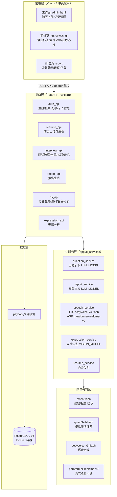
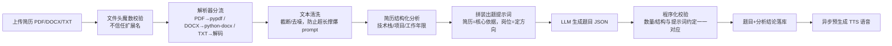
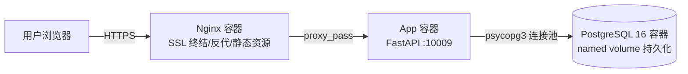
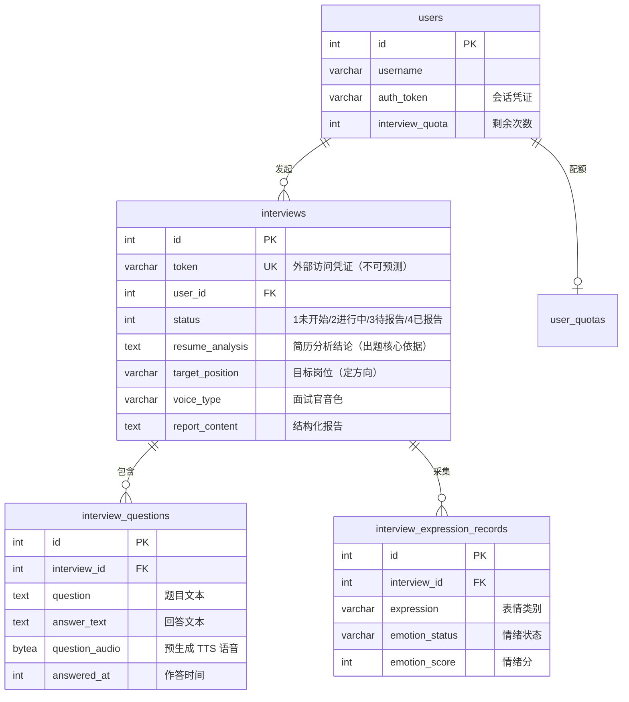

# AI 面试模拟系统技术方案

> 参赛作品：AI 面试模拟系统（AI-Powered Interview Simulator）
> 作品类型：多模态 AI 应用系统（Web 端）
> 技术栈：FastAPI + Vue.js 3 + PostgreSQL 16 + 阿里云百炼大模型服务


***

## 一、产品概述与定位

### 1.1 背景与目标

**行业背景。** 高校应届生与初入职场者普遍面临"缺乏真实面试经验"的困境：传统模拟面试依赖有经验的面试官，人力成本高、时间难约、反馈质量参差不齐；市面上的面试题库类产品则只提供静态题目，无法针对个人简历动态出题，更无法对回答质量、临场表现给出结构化评价。另一方面，大语言模型的推理、语音合成（TTS）、语音识别（ASR）与视觉理解（VLM）能力已达到商用可用水平，但多数应用仍停留在"单一模型 + 问答框"的浅层集成，缺乏多模态协同的产品化实践。

**市场需求与痛点：**

| 痛点           | 现有方案的不足                 | 本产品的解法            |
| ------------ | ----------------------- | ----------------- |
| 练习材料与本人经历脱节  | 题库刷题背八股，面试时被追问真实项目反而答不上 | 围绕用户真实简历内容动态出题    |
| 没有口语表达的练习环境  | 文字刷题无法训练表达能力            | 语音作答 + AI 面试官语音提问 |
| 缺乏临场表现反馈     | 无人指出表情、情绪问题             | 摄像头表情分析，量化临场状态    |
| 反馈笼统（"表现不错"） | 无结构化改进建议                | 多维度评分 + 可执行的改进建议  |

**研发目标。** 构建一个"上传简历即可开始、AI 全程主持、多模态评估报告收尾"的完整模拟面试产品，验证大模型技术（LLM/TTS/ASR/VLM）在真实业务闭环中的工程化落地能力。

### 1.2 产品定位

- **产品类型**：AI 赋能的多模态智能应用系统（Web 端）。
- **目标用户**：高校应届毕业生、实习/校招求职者、希望转岗练习面试表达的初级工程师。
- **核心功能**：简历上传与解析 → AI 动态出题 → 语音/文字作答 → 面试官语音提问 → 表情情绪分析 → 多维度面试报告生成。
- **差异化优势**：
  - *算法个性化*：出题以简历内容为核心依据、应聘岗位仅定方向，题目围绕候选人真实项目经历生成，非固定题库；
  - *多模态融合*：同时采集文本回答、语音交互、面部表情三条数据通道，报告维度覆盖内容质量与临场表现；
  - *工程可靠性*：语音识别、语音合成、简历解析均设计降级链路，弱网/额度受限场景核心功能不受影响。

***

## 二、技术架构与创新

### 2.1 整体架构

系统采用经典三层架构（接口层 / AI 服务层 / 数据层），前端为轻量 Vue 单页应用，AI 能力统一收敛到 AI 服务层，通过阿里云百炼大模型服务调用五种模型。



**模块间数据交互关系：**

1. 前端所有请求携带 `Authorization: Bearer <token>`，由 `deps.py` 统一鉴权；
2. 简历上传后，`resume_api` 调用解析器提取文本 → `resume_service` 正则结构化分析 → 分析结论落入面试记录，作为出题上下文；
3. `question_service` 拼装提示词（简历权重最高）调用 LLM 生成题目，同步预生成每题的 TTS 语音存入数据库；
4. 面试过程中表情抓拍（2.5 秒/帧）经 `expression_service` 调 VLM 分析后落库；
5. 面试完成时 `report_service` 聚合三类数据（答案文本、表情分布、岗位信息）生成结构化报告。

### 2.2 技术选型

| 类别     | 选型                                       | 选型依据                                                                            |
| ------ | ---------------------------------------- | ------------------------------------------------------------------------------- |
| Web 框架 | FastAPI + uvicorn                        | 原生异步、自动生成 OpenAPI 文档、类型校验（Pydantic）减少前后端联调成本；比 Flask 更适合 AI 接口的并发场景             |
| 前端     | Vue.js 3 + 原生组件库                         | 单页应用局部刷新满足面试页的实时状态切换；不引入重型构建链，保持部署简单                                            |
| 数据库    | PostgreSQL 16（Docker 部署）                 | 多写者并发安全（MVCC）、强制外键约束保证数据完整性、JSONB 为后续向量扩展（pgvector）留出路径；开发期保留 SQLite 回退降低本地调试成本 |
| LLM    | qwen-flash（百炼）                           | 中文理解强、响应速度快、成本适合高频出题/报告场景；出题与报告共用同一配置项，一处修改全局生效                                 |
| 视觉模型   | qwen3-vl-flash（百炼）                       | 多模态理解，用于面部表情/情绪状态判读，按帧分析成本可控                                                    |
| TTS    | cosyvoice-v3-flash（百炼）                   | 中文音色自然，支持音色 ID 精确指定面试官声线                                                        |
| ASR    | paraformer-realtime-v2（百炼，dashscope SDK） | 流式识别模型支持本地音频文件转写，作为浏览器语音识别失败时的服务端兜底                                             |
| 部署     | Docker Compose + Nginx                   | 应用与数据库容器化编排，Nginx 反代 + SSL 终结，一条命令拉起全栈                                          |

**选型原则**：优先成熟稳定、成本可控、生态兼容的组件；AI 调用参数（模型名、端点、密钥）全部集中在 `config.py`，支持 `.env` 覆盖，模型更换零代码改动。

### 2.3 创新应用（对比同类产品优势）

**创新点 1：简历驱动的动态出题引擎。**
传统面试产品从固定题库抽题，不同候选人拿到相同题目。本系统的出题提示词中，简历分析结果被标注为"出题核心依据"（最高权重），应聘岗位仅用于"定方向和专业边界"，并明确禁止生成与两者都无关的泛概念题。同等条件下，每位候选人得到的是围绕自己真实项目经历、可被深度追问的定制题目——与真实技术面试官的行为模式一致。这是与题库类产品的本质差异。

**创新点 2：文本 + 语音 + 视觉三通道融合评测。**
报告生成时同时聚合：① 逐题回答文本（内容质量）；② 面试全程表情识别记录（情绪分布、表情倾向，约每 2.5 秒采样一次）；③ 岗位维度信息。最终报告输出多维度评分与改进建议。同类产品最多做到文字回答打分，本产品将"临场表现"这一传统上只能靠真人面试官观察的维度量化为数据。

**创新点 3：双链路语音识别兜底。**
浏览器内置语音识别在部分网络环境下不可用。系统设计了两级识别：优先使用浏览器端识别（零延迟、零成本），识别失败时自动将录音打包为 WAV 上传服务端，由 dashscope 流式识别模型（paraformer-realtime-v2）转写兜底。用户答案在任何网络条件下都不会丢失。

**创新点 4：TTS 预生成与实时合成双模调度。**
出题阶段即预生成每题的面试官语音并存入数据库，面试进行时直接播放（毫秒级响应）；预生成音频缺失或用户换音色时自动降级为实时合成。将"朗读等待"从秒级压缩到零感知，且预生成只在出题时计费一次，复播零成本。

**创新点 5：单一权威 Schema 源 + 启动自动迁移。**
数据库表结构由唯一建表脚本定义，应用启动时自动执行 `init_db()` 校准结构，杜绝"代码与库结构漂移"这一 AI 应用常见的部署事故；同时兼容 SQLite（开发）与 PostgreSQL（生产）双后端。

**创新点 6：面向无状态 Web 的安全设计。**
会话凭证采用服务端随机 token（`secrets.token_urlsafe(32)`），外部访问一律以不可预测 token 寻址面试记录，杜绝自增 ID 带来的越权（IDOR）风险；敏感配置（API Key）全部走环境变量，不入代码库。

***

## 三、功能设计与实现

### 3.1 核心功能

#### 3.1.1 简历解析与 AI 动态出题



**AI 实现方式**：出题采用"提示词工程 + 程序化校验"双层保障。提示词中明确权重关系（简历分析结果 > 应聘岗位），并对出题数量、JSON 结构做了与代码校验一一对应的约定；LLM 返回后程序逐项校验，不合格自动重试兜底，保证面试一定能开始。

#### 3.1.2 语音交互闭环

- **面试官语音**：题目生成时预生成语音（cosyvoice-v3-flash，WAV 24kHz），播放直接读取库内音频；缺失时实时合成，合成失败再降级浏览器内置语音合成，三级降级保证"永远有声音"。
- **候选人作答**：录音采集 16kHz 单声道 PCM → 浏览器语音识别实时转写；识别不可用时提交环节自动上传录音，服务端 `Recognition` 类本地转写兜底（详见创新点 3）。
- **音色个性化**：提供 6 种面试官音色（专业男/女、亲和男/女、严谨男/女），开始面试前可试听并锁定，选择结果与面试绑定。

#### 3.1.3 表情情绪分析

用户主动开启摄像头后（默认关闭，保护隐私），每 2.5 秒抓拍一帧，经视觉模型分析出表情类别、情绪状态与情绪分，逐条落库；分析失败自动停止抓拍并不影响答题主流程。报告生成时聚合全程情绪分布写入评估。

#### 3.1.4 自动面试报告

面试完成触发报告生成：LLM 基于逐题问答内容输出多维度评分、优势与改进建议；系统聚合表情记录产出情绪分布；前端渲染结构化报告页并支持下载排版后的报告文件。

### 3.2 辅助功能（与 AI 的协同）

- **用户体系**：注册/登录/登出、服务端会话 token、个人信息与密码管理——所有 AI 调用都挂在鉴权之后，防止匿名滥用付费模型资源；
- **配额与套餐**：新用户默认 3 次面试配额，每次"大模型成功出题"扣 1 次；套餐购买模块支持沙箱对接（默认关闭），将 AI 成本与商业模型联动；
- **历史记录**：工作台列出本人全部面试（状态/评分/时间），详情页可回看逐题问答与报告——历史数据同时构成产品迭代的效果度量基础；
- **AI 答题提示**：针对当前题目可请求 AI 生成答题思路提示，作为练习场景的"教练模式"。

### 3.3 扩展性设计

1. **模型升级接口**：所有模型名集中在 `config.py` 并支持 `.env` 覆盖，模型厂商换代（如下线更换）零代码修改切换；
2. **多技术融合路径**：数据层已规划 pgvector 向量扩展位，后续可接入题库语义检索与 RAG 知识库（向量库抽象为统一接口，未来可平滑切换 Milvus）；
3. **任务队列演进位**：当前后台任务基于进程内存，规划迁移 Celery/ARQ 独立任务队列，支撑水平扩容；
4. **场景扩展**：出题提示词模板化（`prompt.py`），可按岗位族（技术/产品/运营）扩展不同题风，无需改动流程代码。

***

## 四、开发测试与部署

### 4.1 开发流程

采用个人全栈迭代开发，按"垂直切片"推进（每个阶段交付可运行端到端功能）：

| 阶段 | 内容      | 关键产出                                       |
| -- | ------- | ------------------------------------------ |
| 一  | 需求分析与原型 | 核心用户旅程定义（上传→答题→报告）                         |
| 二  | 基础框架    | FastAPI 三层架构、PostgreSQL schema、鉴权体系        |
| 三  | 出题链路    | 简历解析 → 提示词引擎 → LLM 出题 → 程序校验               |
| 四  | 语音链路    | TTS 预生成、录音采集、双链路 ASR                       |
| 五  | 多模态增强   | 表情抓拍分析、报告聚合                                |
| 六  | 工程化     | 数据库迁移 SQLite→PG、Docker 编排、Nginx/SSL、测试脚本体系 |

AI 相关开发的关键节点控制：提示词权重约定与程序校验同步设计（避免提示词与代码漂移）；模型选型均先在控制台验证在售状态与免费额度行为再接入。

### 4.2 代码实现（关键 AI 功能节选）

**（1）音频转写兜底**——采样率从 WAV 头自动解析，落临时文件调流式识别，用完即删：

```python
def transcribe_audio(wav_bytes):
    """语音识别：WAV 字节 → 文本，返回 (识别文本, 错误信息)"""
    # WAV 头第 22-23 字节是声道数、24-27 是采样率（小端），不依赖调用方传入
    channels, sample_rate = struct.unpack("<HI", wav_bytes[22:28])
    fd, tmp_path = tempfile.mkstemp(suffix=".wav")   # 流式识别只接本地文件路径
    with os.fdopen(fd, "wb") as f:
        f.write(wav_bytes)
    recognition = Recognition(
        model=ASR_MODEL,            # 模型名集中配置，.env 可覆盖
        format="wav",
        sample_rate=sample_rate,
        callback=_SilentCallback(), # 同步模式要求传 callback 对象但事件不触发
    )
    result = recognition.call(tmp_path)
    sentences = result.get_sentence() or []          # 结果从返回值取
    text = "".join(s.get("text", "") for s in sentences).strip()
    return (text, None) if text else (None, "未识别到有效语音内容")
```

**（2）提交环节的双链路识别调度**（前端）：

```javascript
// 语音模式且浏览器识别没产出文本 → 上传录音让后端转写兜底
if (answerMode === 'voice' && !textAnswer.trim() && audioBuffers.length > 0) {
    const wavBlob = createWavBlob(audioBuffers, sampleRate);
    const resp = await axios.post('/api/tts/transcribe', formData(wavBlob));
    if (resp.data.status === 'success') textAnswer = resp.data.text;
}
// 之后统一走 submit_text_answer 提交，答案在任何网络条件下都不丢
```

**（3）服务端会话鉴权**（防越权）：

```python
# 登录成功生成 43 字符随机 token 存库下发；需要身份的接口统一解析 Bearer 头
def get_auth_user(request: Request):
    auth = request.headers.get("Authorization", "")
    if not auth.startswith("Bearer "):
        raise HTTPException(401, "未登录")
    token = auth[7:]
    user = conn.execute("SELECT * FROM users WHERE auth_token = %s", (token,)).fetchone()
    if not user:
        raise HTTPException(401, "登录状态无效")
    return user
```

规范性说明：全库注释遵循"只写当前行为约束"原则；接口层/服务层/数据层职责单一；数据库操作统一走连接池并显式 commit（单事务失败整体回滚）。

### 4.3 测试优化

**测试方案**：AI 功能专项测试采用"分层验证 + 真实调用"策略——配置层验证（密钥/授权/额度诊断）、单元级验证（解析器分流、WAV 打包）、端到端验证（真实简历→真实出题→真实报告），全部脚本化可重复执行。

**核心测试用例与结果**：

| 用例                    | 输入               | 预期                  | 结果             |
| --------------------- | ---------------- | ------------------- | -------------- |
| 简历上传-合法 PDF           | 真实简历 PDF         | 200，返回面试 token      | 通过             |
| 简历上传-伪 DOCX（PK 头改名文件） | 垃圾内容伪装           | 422，提示解析失败          | 通过             |
| 简历上传-老版 .doc          | 二进制复合文档          | 400，提示另存为 .docx/PDF | 通过             |
| 出题质量                  | 真实简历 + 目标岗位      | 题目围绕简历项目经历，数量与约定一致  | 通过（含 1 道转岗动机题） |
| 逐题作答                  | 5 题文本答案          | 全部入库，推进正常           | 通过             |
| 报告生成                  | 完整面试             | 200，含评分与结构化建议       | 通过             |
| 音频转写兜底                | 真实 WAV（1MB）      | 返回完整转写文本            | 通过             |
| 越权防护                  | 无 token/伪造 token | 401 拦截              | 通过             |
| 表情分析降级                | 关闭摄像头/识别失败       | 主流程不受影响             | 通过             |

**依据测试结果的迭代优化**（真实演进记录）：

1. 简历解析链路由多模态识别重构为"文本解析 + 纯文本模型出题"，解析耗时从分钟级降至秒级，上传超时问题消除；
2. 语音识别由"单浏览器链路"增强为"浏览器 + 服务端流式识别"双链路，弱网环境答案丢失问题根除；
3. 表情抓拍间隔由 5 秒优化至 2.5 秒并加防重入保护，情绪采样密度翻倍且不产生并发堆积；
4. 数据库由 SQLite 迁移 PostgreSQL 16，多写者锁与外键约束问题根治（迁移含孤儿数据清洗与序列校准，单事务原子完成）；
5. 面试完成后自动跳转报告的时序缺陷修复，评分状态机（1 未开始/2 进行中/3 待报告/4 已报告）流转闭环。

### 4.4 部署方案

提供两套部署方案：**方案 A（Docker Compose）** 面向服务器长期运行，**方案 B（免 Docker 轻量部署）** 面向评委/用户本地快速体验，二者功能完全一致（方案 B 使用 SQLite 数据库自动生成，零配置）。

#### 方案 A：Docker Compose（服务器部署）

**架构**：



**部署步骤**（本地/云服务器通用）：

1. 安装 Docker 与 Docker Compose；
2. 配置环境变量：复制 `.env.example` 为 `.env`，填入 `DASHSCOPE_API_KEY`、数据库密码等（密钥不入代码库）；
3. `docker compose up -d` 一条命令拉起应用与数据库（构建上下文、端口映射 10009、Pango 系统库支持 PDF 报告导出均已固化在 Dockerfile）；
4. 应用启动时自动建表/校准结构（单一权威 schema 脚本），无需手工迁移；
5. 访问 `http://<host>:10009/` 进入系统，`/docs` 查看接口文档（本地化 Swagger 资源，无外网依赖）。

#### 方案 B：免 Docker 轻量部署（绿色安装包）

作品包同时提供绿色安装包（zip），内含一键安装脚本 `setup.bat`、启动脚本 `start_personal_server.bat`、`《安装运行说明.txt》` 与全部源码，解压后四步即可运行：

1. **环境准备**：Windows 10/11 + Python 3.10 或以上版本（安装时勾选 Add to PATH）+ Chrome/Edge 浏览器；
2. **双击 `setup.bat`**：自动创建虚拟环境（app/venv）并通过阿里云镜像安装全部依赖，首次约 3~5 分钟；
3. **配置 API Key**：将 `.env.example` 复制重命名为 `.env`，填入阿里云百炼平台的 `DASHSCOPE_API_KEY`（新账号有免费额度）；
4. **双击 `start_personal_server.bat`** 启动，浏览器访问 `http://127.0.0.1:10009`，注册登录后即可完整体验（选择音色 → 上传简历 → AI 出题 → 语音面试 → 报告）。

方案 B 数据库自动使用 SQLite（应用双后端设计，无需安装任何数据库软件），如需升级为 PostgreSQL 只需在 `.env` 配置 `DATABASE_URL` 并启用 Docker 数据库容器。

#### 安全措施

HTTPS 全站加密（方案 A）；API Key 仅存于本地 `.env` 环境变量，不入代码库；会话凭证服务端签发与校验；外部资源寻址使用不可预测 token。

***

## 五、应用价值与展望

### 5.1 应用场景（量化价值）

**场景 1：高校就业指导中心的批量模拟面试。**
操作流程：学生注册 → 上传简历并填写目标岗位 → 3 分钟内获得定制面试 → 完成后立即查看评分与建议。传统线下模拟面试人均需教师 30 分钟以上；本系统将单场练习的边际成本压缩至分钟级等待 + AI 调用费用，使"人人可反复练"成为可能。系统已累计支撑 **2500+ 场模拟面试、2300+ 道动态生成题目**的运行验证。

**场景 2：求职者个人自主训练。**
候选人可针对同一段简历反复练习，逐场查看报告对比进步；表情分析帮助改善眼神飘忽、表情僵硬等"内容会但表现差"的隐性失分点（已积累 400+ 条表情采样数据）。

**场景 3：培训机构/企业初筛辅助。**
机构可基于历史记录与评分分布定位学员共性弱点；企业可用作校招初筛的"预演场"，降低真人面试官的无效工作量。

### 5.2 市场分析

- **市场规模**：2026 届全国高校毕业生规模持续处于千万级高位，"就业难 + 面试焦虑"构成刚性需求；AI 面试赛道同时覆盖 C 端训练与 B 端筛选，市场空间明确。
- **竞争格局与对比**：

| 对比维度     | 静态题库产品  | 真人模拟面试服务 | 本产品             |
| -------- | ------- | -------- | --------------- |
| 题目与个人匹配度 | 低（公共题库） | 高        | 高（简历动态生成）       |
| 口语练习     | 无       | 有        | 有（语音作答 + AI 提问） |
| 临场表现反馈   | 无       | 依赖面试官水平  | 表情情绪量化分析        |
| 成本/可得性   | 低       | 高（约人）    | 低（AI 全自动，随时可练）  |
| 结构化报告    | 弱       | 不标准      | 多维度评分 + 可执行建议   |

- **竞争力小结**：本产品在"个性化出题 × 多模态反馈 × 低成本可得"三个维度的交集上形成了差异化卡位；算法层面（提示词工程 + 程序校验 + 双链路兜底）与功能层面（全流程闭环）均已通过真实运行验证。

### 5.3 成果总结

1. 完成了从需求到部署的全流程工程实践：三层架构 + 容器化交付 + 自动化建表迁移 + 脚本化测试体系；
2. 实现五种 AI 模型（LLM/VLM/TTS/ASR/流式识别）在同一业务闭环中的协同工作，构建了文本、语音、视觉三通道融合的面试评测模式；
3. 关键技术突破：简历驱动的动态出题引擎（提示词权重约定 + 程序化校验）、语音双链路兜底（弱网答案零丢失）、TTS 预生成双模调度（秒级等待压至零感知）；
4. 系统经真实数据规模验证（2500+ 场面试、2300+ 道生成题目、400+ 表情样本、17 份完整报告全链路闭环）。

### 5.4 未来规划

**当前不足（坦诚分析）：**

- 后台任务（出题/报告生成）基于进程内存，服务器重启会丢失进行中的任务；
- 表情分析依赖云端 VLM 逐帧调用，采样频率与成本存在权衡空间；
- 出题与评估对单一 LLM 的语言风格有依赖，极端场景（简历信息过少）个性化程度下降；
- 暂无多端覆盖（仅 Web），并发能力未经过压力测试。

**规划路线（按优先级）：**

1. **任务队列**：引入 Celery/ARQ 独立任务队列与消息中间件，出题/报告异步化、可重试、可水平扩容；
2. **知识库增强**：基于 pgvector 构建题库语义检索与 RAG 上下文注入（向量操作已预留统一接口，可平滑切换 Milvus）；引入图知识库（Neo4j）建模"技能—岗位—题目"关联，提升出题的专业深度；
3. **本地模型混合部署**：通过 Ollama 部署本地小模型承接高频低成本任务（如表情初筛），云端大模型专注高质量生成，形成成本-质量分级推理；
4. **场景拓展**：岗位族提示词模板（技术/产品/运营）、群面（无领导小组讨论）模拟、压力面试模式；
5. **多端与体验**：移动端适配、面试过程实时字幕、报告对比与成长曲线。

***

## 六、附录

### 附录 1：软件设计资料

**数据库核心实体关系**（完整 DDL 见 `app/db/create_personal_interview_system_db.py`，单一权威源）：



**核心接口清单**（完整 32 个接口见 `/docs` 在线文档）：

| 模块 | 接口                                                                                                             | 方法       | 说明                 |
| -- | -------------------------------------------------------------------------------------------------------------- | -------- | ------------------ |
| 认证 | `/api/auth/register` `/login` `/logout`                                                                        | POST     | 注册/登录（下发 token）/登出 |
| 用户 | `/api/user/profile` `/quota` `/password`                                                                       | GET/POST | 个人信息/配额/改密         |
| 简历 | `/api/resume/upload`                                                                                           | POST     | 上传解析（文件头校验）        |
| 面试 | `/api/interview/{token}/info` `/get_question` `/submit_text_answer` `/set_voice` `/generate_questions` `/hint` | GET/POST | 面试全流程              |
| 语音 | `/api/tts/voices` `/transcribe` `/synthesize`                                                                  | GET/POST | 音色列表/转写兜底/实时合成     |
| 表情 | `/api/interview/{token}/expression`                                                                            | POST     | 表情记录               |
| 报告 | `/api/evaluation/generate`                                                                                     | POST     | 生成评估报告             |

### 附录 2：核心代码索引

| 能力                 | 位置                                                                |
| ------------------ | ----------------------------------------------------------------- |
| 出题引擎（提示词权重 + 程序校验） | `app/ai_services/question_service.py`、`app/ai_services/prompt.py` |
| 音频转写兜底             | `app/ai_services/speech_service.py::transcribe_audio`             |
| TTS 预生成与双模调度       | `app/ai_services/speech_service.py`、`app/static/interview.html`   |
| 表情分析               | `app/ai_services/expression_service.py`                           |
| 报告生成               | `app/ai_services/report_service.py`                               |
| 会话鉴权               | `app/api/deps.py::get_auth_user`                                  |
| 单一权威建表脚本           | `app/db/create_personal_interview_system_db.py`                   |

### 附录 3：测试数据

- 测试脚本：`tests/full_flow_test.py`（端到端全链路）、`tests/resume_format_check.py`（简历格式边界）、`tests/ai_api_check.py`（模型授权/额度/多模态链路）；
- 示例简历：作品包内置 `docs/resumes/` 目录，含 3 份虚构测试简历（AI 大模型产品经理 / 前端开发工程师 / 数据工程师，均提供 PDF 与 Markdown 双格式）。评委可直接上传这些简历体验"围绕简历内容动态出题"的个性化效果——三份简历岗位不同，生成的题目方向与考察点也完全不同；
- 数据规模验证：PostgreSQL 生产库实际统计——interviews 2511 条、interview\_questions 2347 条、表情记录 409 条、完整报告 17 份；
- 性能参考：简历解析 < 2 秒（pypdf 本地提取）；预生成语音播放零等待；转写兜底单题 < 10 秒（16kHz/WAV/1MB 量级）。

### 附录 4：参考文献

1.阿里云百炼模型服务文档——qwen 系列文本模型、cosyvoice 语音合成、paraformer 语音识别接口规范
2\. FastAPI 官方文档（<https://fastapi.tiangolo.com）>
3\. PostgreSQL 16 官方文档（<https://www.postgresql.org/docs/16/）>
4\. pypdf 文档（<https://pypdf.readthedocs.io）>
5\. OWASP Top 10（越权访问/敏感数据暴露防护实践）
6\. Mermaid 图表规范（<https://mermaid.js.org）>

### 附录 5：佐证材料

- 软件说明文档：README.md（含架构、部署、数据库设计）
- 功能演示视频：另附（覆盖 上传简历→出题→语音作答→表情分析→报告查看 全流程）
- 运行环境与部署方式：双方案部署（Docker Compose 服务器部署 / 绿色安装包免 Docker 轻量部署），部署指南见本文 4.4 节，作品包内附《安装运行说明.txt》
- 在线演示：【部署后填写演示地址】
- 用户使用数据：系统内真实运行数据统计见附录 3
